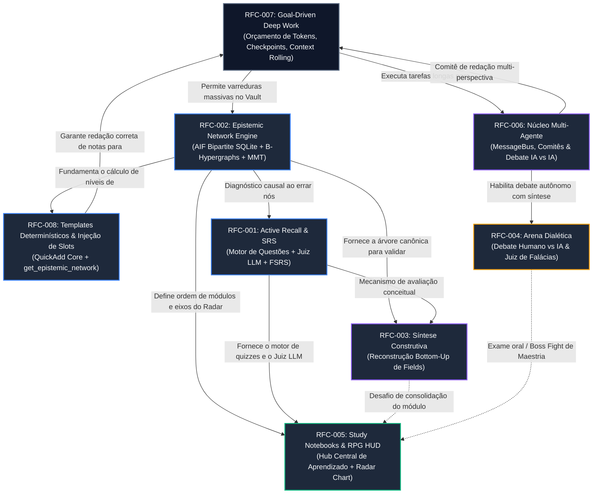

# RFCs do JARVIS (Request for Comments)

Este diretório contém as especificações executivas e propostas arquiteturais para novas capacidades de alto impacto no JARVIS.

Todas as propostas aqui listadas estão atualmente em estágio de design e discussão aberta (`EM ANDAMENTO / RFC`).

---

## Índice de Documentos

| RFC | Título | Status | Foco Principal |
| :--- | :--- | :--- | :--- |
| **[RFC-001](file:///home/zrhyan/Principal/Computation/JARVIS/docs/rfcs/rfc-001-active-recall-automated-srs.md)** | Active Recall & Automated Spaced Repetition | `EM ANDAMENTO / RFC` | Quizzes, Flashcards, Perguntas Abertas e Avaliação Algorítmica por LLM com FSRS/SM-2. |
| **[RFC-002](file:///home/zrhyan/Principal/Computation/JARVIS/docs/rfcs/rfc-002-epistemic-dag-ontology.md)** | Epistemic Network Engine | `EM ANDAMENTO / RFC` | Modelagem formal bipartida AIF, B-Hipergrafos no SQLite, MMT Theory Graphs por campo e algoritmo de Eades. |
| **[RFC-003](file:///home/zrhyan/Principal/Computation/JARVIS/docs/rfcs/rfc-003-constructive-synthesis-exercises.md)** | Exercícios de Síntese Construtiva do Conhecimento | `EM ANDAMENTO / RFC` | Desafios macro em nível de *Field Note* para reconstrução dedutiva bottom-up (dos primitivos aos teoremas). |
| **[RFC-004](file:///home/zrhyan/Principal/Computation/JARVIS/docs/rfcs/rfc-004-dialectic-rhetoric-arena.md)** | Dialectic & Rhetoric Arena (Debate & Disputatio) | `EM ANDAMENTO / RFC` | Sparring partner dialético sob regras de *Disputatio Escolástica*, debate acadêmico e juiz de falácias. |
| **[RFC-005](file:///home/zrhyan/Principal/Computation/JARVIS/docs/rfcs/rfc-005-study-notebooks-rpg-mastery.md)** | Interactive Study Notebooks & RPG Mastery HUD | `EM ANDAMENTO / RFC` | Cadernos de estudo por campo (`field`), trilhas modulares, simulados com dificuldade e HUD de atributos em Gráfico de Radar/Teia. |
| **[RFC-006](file:///home/zrhyan/Principal/Computation/JARVIS/docs/rfcs/rfc-006-multi-agent-orchestration.md)** | Multi-Agent Collaboration & Dialectic Swarm | `EM ANDAMENTO / RFC` | Orquestração multi-agente: debate autônomo IA vs IA com convergência obrigatória e comitê de especialistas multifacetado. |
| **[RFC-007](file:///home/zrhyan/Principal/Computation/JARVIS/docs/rfcs/rfc-007-goal-driven-autonomous-execution.md)** | Goal-Driven Autonomous Execution & Deep Work | `EM ANDAMENTO / RFC` | Execução autônoma de longo prazo (`/goal`) em background com orçamento estrito de tokens, rolling context e checkpoints crash-safe. |
| **[RFC-008](file:///home/zrhyan/Principal/Computation/JARVIS/docs/rfcs/rfc-008-deterministic-templates-and-epistemic-tree.md)** | Deterministic Templates & Epistemic Network | `EM ANDAMENTO / RFC` | Motor de templates estilo QuickAdd, ferramenta `get_epistemic_network` (níveis topológicos por campo) e regras modulares. |

---

## Mapeamento de Dependências Técnicas

Para evitar retrabalho, código descartável ou criação de mocks artificiais, as implementações respeitam a cadeia de dependências entre infraestrutura de execução, modelagem de dados e interfaces de alto nível:

---

## Roteiro Estratégico de Implementação por Fases

| Fase | RFCs Alvo | Módulos Impactados | Entrega Principal |
| :---: | :--- | :--- | :--- |
| **Fase 1** | **[RFC-002](file:///home/zrhyan/Principal/Computation/JARVIS/docs/rfcs/rfc-002-epistemic-dag-ontology.md)** & **[RFC-008](file:///home/zrhyan/Principal/Computation/JARVIS/docs/rfcs/rfc-008-deterministic-templates-and-epistemic-tree.md)** | `@jarvis/core`, `@jarvis/daemon` | **Fundação de Escrita & Ontologia:** Motor de templates determinístico (QuickAdd core), nova ferramenta `get_epistemic_network` (níveis topológicos 0, 1, 2 por campo) e comandos tipados. |

| **Fase 2** | **[RFC-001](file:///home/zrhyan/Principal/Computation/JARVIS/docs/rfcs/rfc-001-active-recall-automated-srs.md)** | `@jarvis/daemon`, `@jarvis/core` | **Motor de Avaliação & SRS:** Geração multimodal de exercícios (quiz, card, aberta); *Judge LLM* para pontuação objetiva; tabelas de agendamento FSRS/SM-2 no SQLite. |
| **Fase 3** | **[RFC-007](file:///home/zrhyan/Principal/Computation/JARVIS/docs/rfcs/rfc-007-goal-driven-autonomous-execution.md)** | `@jarvis/daemon`, `@jarvis/core` | **Deep Work Engine (`/goal`):** Execução assíncrona em background com orçamento estrito de tokens, rolling context/scratchpad, checkpoints e proteção anti-looping. |
| **Fase 4** | **[RFC-006](file:///home/zrhyan/Principal/Computation/JARVIS/docs/rfcs/rfc-006-multi-agent-orchestration.md)** | `@jarvis/daemon`, `@jarvis/core` | **Núcleo Multi-Agente:** Barramento de mensagens (`AgentMessageBus`), comitês com isolamento de contexto e motor de debate autônomo com convergência obrigatória. |
| **Fase 5** | **[RFC-003](file:///home/zrhyan/Principal/Computation/JARVIS/docs/rfcs/rfc-003-constructive-synthesis-exercises.md)** | `@jarvis/core`, `@jarvis/web` | **Exercícios de Síntese Macro:** Validador de encadeamento bottom-up para notas do tipo `field` contra o DAG canônico. |
| **Fase 6** | **[RFC-005](file:///home/zrhyan/Principal/Computation/JARVIS/docs/rfcs/rfc-005-study-notebooks-rpg-mastery.md)** | `@jarvis/web`, `@jarvis/daemon` | **Hub de Notebooks & HUD de RPG:** UI do Study Notebook, parser de capítulos do sumário temático, Radar Chart com eixos de atributos, categorias *Strengths*/*Focus Areas* e simulador customizável. |
| **Fase 7** | **[RFC-004](file:///home/zrhyan/Principal/Computation/JARVIS/docs/rfcs/rfc-004-dialectic-rhetoric-arena.md)** | `@jarvis/daemon`, `@jarvis/web` | **Arena Dialética & Disputatio:** Motor de turnos formais (*Disputatio*, Parlamentar, Socrático), juiz de falácias lógicas e integração como exame de maestria de Notebooks. |
