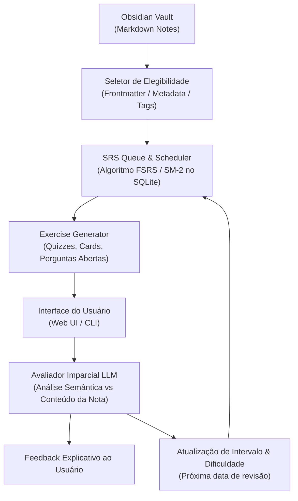

# RFC-001: Active Recall & Automated Spaced Repetition (SRS Inteligente)

* **Status:** `EM ANDAMENTO / RFC`
* **Autor:** zRhyan & JARVIS
* **Data de Criação:** 2026-10-21
* **Última Atualização:** 2026-10-21
* **Módulo Alvo:** `@jarvis/daemon`, `@jarvis/core`, `@jarvis/web`

---

## 1. Contexto e Motivação

Atualmente, o aprendizado baseado no Obsidian conta primordialmente com o plugin comunitário *Spaced Repetition*. No fluxo atual de notas do usuário:
1. O plugin seleciona notas aleatórias previamente marcadas com tags específicas (`#review`, etc.) seguindo seu algoritmo interno.
2. O usuário revisa a nota inteira — sem um formato estrito de pergunta/resposta (frente e verso).
3. Ao final da leitura, o próprio usuário autoavalia sua retenção atribuindo manualmente uma classificação subjetiva (*Fácil*, *Médio*, *Difícil*).

### Limitações do Modelo Vigente:
* **Viés de Autoavaliação:** O julgamento humano sobre a própria retenção é frequentemente falho (ilusão de competência ao reler uma nota passivamente).
* **Falta de Desafio Ativo Direcionado:** Ler a nota passivamente é significativamente menos eficiente do que ser forçado a evocar conceitos específicos (*active recall*).
* **Ausência de Avaliação Qualitativa:** O plugin convencional não corrige respostas abertas nem aponta nuances conceituais omitidas.

O JARVIS possui acesso completo ao Vault e ao histórico conceitual, permitindo uma abordagem ativa, algorítmica e pedagogicamente superior.

---

## 2. Objetivos Principais

1. **Geração Multimodal de Exercícios Conceituais:**
   * **Quizzes:** Questões de múltipla escolha com alternativas plausíveis e distratores que testam confusões comuns no tema.
   * **Flashcards Atômicos:** Desafios diretos de estímulo-resposta (definição $\leftrightarrow$ termo, propriedade $\leftrightarrow$ aplicação).
   * **Perguntas Abertas:** Desafios discursivos onde o usuário deve explicar a mecânica, justificativa ou prova de um conceito com suas próprias palavras.

2. **Avaliação Algorítmica Automatizada por LLM:**
   * O JARVIS avalia a resposta fornecida pelo usuário comparando-a contra o conteúdo canônico da nota.
   * Pontuação objetiva baseada em:
     * Fidelidade aos termos e definições fundamentais.
     * Ausência de contradições lógicas.
     * Completude da explicação.
   * O score numérico alimenta diretamente a função de repetição espaçada, sem necessidade de autoavaliação manual subjetiva.

3. **Filtro Rigoroso de Elegibilidade de Notas:**
   * Garantir que apenas notas adequadas (conceitos, definições, teoremas, modelos mentais) sejam alvos de SRS.
   * Excluir estritamente documentações de projeto, notas de configuração, templates, notas administrativas e diárias.

---

## 3. Arquitetura Proposta

### 3.1. Algoritmo de Repetição Espaçada
* Avaliar o uso de **FSRS (Free Spaced Repetition Scheduler)** em detrimento do clássico SM-2, devido à maior precisão matemática ao modelar estabilidade e retenção.
* Manter o estado do agendamento (intervalos, estabilidade, histórico de tentativas e pontuações) em tabela dedicada no banco de dados local do daemon (`jarvis.db`).

---

## 4. Pontos em Aberto e Tópicos para Discussão (RFC)

1. **Modo de Seleção de Formato:**
   * Deve ser fixo por preferência da sessão (ex: *"hoje farei apenas perguntas abertas"*), determinado pelo tipo da nota (ex: definições curtas viram flashcards, notas densas viram perguntas abertas), ou uma combinação ponderada dinâmica?
2. **Integração vs Desacoplamento do Plugin Obsidian:**
   * Devemos sincronizar os metadados de volta no cabeçalho da nota (para compatibilidade caso o usuário abra o Obsidian mobile/sem JARVIS)?
   * Ou o agendamento deve residir 100% no banco de dados do JARVIS para manter o Markdown limpo e livre de poluição de metadados?
3. **Critérios de Elegibilidade:**
   * Qual convenção adotar no Vault?
     - Frontmatter YAML: `type: concept | definition | theorem`
     - Tag dedicada: `#review/srs`
     - Mapeamento explícito a partir dos Maps of Content (MOCs)?
4. **Tratamento de Alucinações do Avaliador:**
   * Como calibrar o prompt do avaliador para que ele não exija palavras exatas (*verbatim*), mas sim precisão conceitual profunda, evitando falsos negativos?
