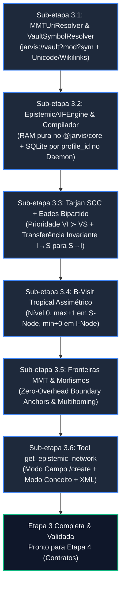

# RFC-002: Epistemic Network Engine — Modelagem Formal Bipartida AIF, B-Hipergrafos & MMT Theory Graphs

* **Status:** `APROVADO / ESPECIFICAÇÃO TÉCNICA E EXECUTIVA DA ETAPA 3`
* **Autor:** zRhyan & JARVIS
* **Data de Criação:** 2026-10-21
* **Última Atualização:** 2026-10-28
* **Módulos Alvo:** `@jarvis/core`, `@jarvis/daemon`, `@jarvis/web`
* **Dependência Direta:** [RFC-008 (Módulo de Templates & Parser Canônico)](file:///home/zrhyan/Principal/Computation/JARVIS/docs/rfcs/rfc-008-deterministic-templates-and-epistemic-tree.md)
* **Pesquisas Fundacionais:**
  - [Relatório de Engenharia e Investigação: Arquitetura AIF em SQLite](file:///home/zrhyan/Principal/Computation/JARVIS/docs/rfcs/researches/gemini-relatorio-de-engenharia-e-investigacao-arquitetura.md)
  - [Arquitetura de Grafos Epistêmicos Acíclicos e Modularidade Algébrica](file:///home/zrhyan/Principal/Computation/JARVIS/docs/rfcs/researches/arquitetura-de-grafos-epistemicos-aciclicos-e-modularidade-algebrica-em-sistemas-de-conhecimento-atomico.md)

---

## 1. Sumário Executivo & Matriz de Entregáveis da Etapa 3

A **Etapa 3** materializa o motor cognitivo formal do JARVIS. O objetivo é dotar o agente local de capacidade dedutiva estrita e contextualização semântica de alta fidelidade sobre o cofre do Obsidian, eliminando alucinações por circularidade, inversão causal e prolixidade explicativa.

Para viabilizar a implementação segura, modular e progressiva desta complexa estrutura algébrica e topológica, a Etapa 3 é particionada em **6 Sub-etapas Sequenciais**, cada uma com seus entregáveis e critérios de aceite estritos:

| Sub-etapa | Componente Principal | Foco Técnico | Entregáveis Concretos | Critérios de Aceite (Gate de Validação) |
| :--- | :--- | :--- | :--- | :--- |
| **3.1** | `MMTUriResolver` & `VaultSymbolResolver` | Endereçamento canônico `jarvis://vault?mod?sym`, Unicode/espaços e resolução contextual de Wikilinks | Parser/validador de URIs tripartidos; suporte a `??sym`, `?/mod?sym`, `?mod?sym` e Wikilinks normais `[[Alvo]]`; convenção de URIs de $S$-nodes (`$ra_k`, `$ca_k`). | Zero colisões entre homônimos; suporte nativo a espaços e acentos UTF-8; resolução cross-domain via header da nota alvo e fallback `isPlaceholder: true`. |
| **3.2** | `EpistemicAIFEngine` & `VaultEpistemicCompiler` | Modelo Bipartido AIF 100% em RAM (`@jarvis/core`) e Persistência SQLite (`@jarvis/daemon`) | Classes ontológicas (`I_NODE`, `S_NODE`), proibição de arestas $I \to I$, compilador `Presupposed` vs `Derived`, extrator de `markdownExcerpt`, contadores $O(1)$ ($d_{\text{intra}}, d_{\text{inter}}$) e repositório SQLite com `profile_id`. | `@jarvis/core` permanece puro sem depender de `better-sqlite3`; `RA-Nodes` criados de `Presupposed Concept(s)`; `markdownExcerpt` ignora o header MOC; sincronia com `VaultWatcherService`. |
| **3.3** | `EadesBipartiteFAS` | Quebra de ciclos não-destrutiva em memória ($O(V+E)$) com Invariante de Corte $S \to I$ | Tarjan SCC ($\vert C \vert \ge 2$); Heurística de Eades com buckets duplamente ligados ($V_I \succ V_S$) + transferência matemática obrigatória de cortes $I \to S$ para a única aresta de saída $S \to I$. | Ciclos são rompidos cortando **100% exclusivamente** arestas de conclusão $S \to I$ (mesmo quando $\delta(S) > \delta(I)$); premissas conjuntas nunca são mutiladas; emissão de `cycleWarning`. |
| **3.4** | `TropicalBVisitSorter` | Estratificação topológica B-Visit com Álgebra Tropical Distinta para $S$-nodes e $I$-nodes | Algoritmo de Kahn B-Visit com `TypedArrays`: Primitivos em nível `0`; Conjunções nos $S$-nodes via $\max(\text{premissas}) + 1$; Disjunções nos $I$-nodes via $\min(\text{esquemas})$ com custo $+0$ na aresta $S \to I$. | Execução em $<3\text{ms}$ para 10.000 nós; zero incremento duplo ($+2$); derivações alternativas ($OU$) recebem estritamente o $\min()$ das vias; `CA_CONFLICT` excluído do cálculo dedutivo. |
| **3.5** | `MMTBoundaryInspector` | Modularidade de Teorias e Morfismos de Inclusão | Classificação $O(1)$ de Primitivos Locais e Âncoras; `boundaryCutIndex` indexado por chave de 32 bits para extração cirúrgica de morfismos $\iota_{A \hookrightarrow B}$. | Zero overhead em tempo de execução; zero achatamento ansioso (*lazy theory flattening*); rastreamento exato do corte entre campos e multihoming sem falsas âncoras. |
| **3.6** | `EpistemicNetworkService` & Daemon Tool | Injeção de Contexto LLM (Modo Campo e Modo Conceito) e Ferramenta `get_epistemic_network` | Serializador XML estratificado para prompts; Tool registrada no daemon com `targetNote` opcional; compatibilidade total com `/create` (notas ainda não criadas) e `get_graph_neighborhood`. | Agente recebe contexto com axiomas (nível 0) antes de derivados; modo `domainField` retorna toda a árvore do campo para `/create`; testes de integração daemon/core passando. |

---

## 2. Roadmap Executivo Detalhado de Implementação (Passo a Passo)



### Sub-etapa 3.1: Identificadores Canônicos MMT-URI Tripartidos, Suporte Unicode e Resolução Contextual de Wikilinks
* **Objetivo:** Estabelecer a camada de endereçamento semântico imune a ambiguidades de nomes de arquivos físicos e colisões homônimas entre notas em domínios diferentes, suportando nativamente nomes reais do Obsidian (com espaços, hífens e acentuação UTF-8) e Wikilinks normais (`[[Nota]]`).
* **Arquivos:**
  - `packages/core/src/epistemic-uri.ts`
  - `packages/core/test/epistemic-uri.test.ts`
* **Implementação Detalhada:**
  1. **Padrão Canônico Unificado (`jarvis://vault`):**
     - `DEFAULT_DOC_URI = "jarvis://vault"` (aceitando também qualquer prefixo válido `scheme://path` como `pkm://vault` ou `jarvis://<profileId>`).
     - `TripartiteMMTUri`: Interface imutável contendo `doc`, `mod`, `sym`, `canonical` (`doc?mod?sym`) e `theoryUri` (`doc?mod`).
  2. **Validação Léxica Compatível com Obsidian (Unicode + Espaços):**
     - Diferente da gramática ASCII restrita da RFC 3986 para URLs de rede, os segmentos `mod` e `sym` no `MMTUriResolver.parseCanonical(rawUri)` **DEVEM permitir caracteres alfanuméricos Unicode (`\p{L}\p{N}`), espaços internos (`" "`), hífens, parênteses, sublinhados, cifrão (`$`) e pontuação de notas Obsidian**, proibindo apenas caracteres de controle e os delimitadores estruturais reservados (`?` e `#`):
       ```typescript
       // Permite letras/números Unicode, espaços e símbolos de notas; proíbe '?' e '#' e caracteres de controle
       private static readonly SEGMENT_REGEX = /^[^\x00-\x1F?#]+$/u;
       ```
     - Normalização de barras (`/`): remover barras vazias ou duplicadas e aplicar `.trim()` em cada sub-segmento separado por `/`.
  3. **Convenção Canônica de Endereçamento de `S-Nodes`:**
     - Como `S-Nodes` (`RA-Nodes` e `CA-Nodes`) não possuem arquivo `.md` próprio mas exigem `canonical_uri` único em memória e no banco, utiliza-se o sub-caminho qualificado MMT sobre o símbolo da nota hospedeira:
       - `RA-Node` da $k$-ésima linha/caminho de `Presupposed Concept(s)` ($k = 0, 1, \dots$): `jarvis://vault?mod?sym/$ra_k`
       - `CA-Node` do $k$-ésimo alvo de conflito de uma nota `Obj - `: `jarvis://vault?mod?sym/$ca_k`
     - Método auxiliar determinístico: `MMTUriResolver.buildSchemeUri(hostNoteUri: TripartiteMMTUri, kind: 'ra' | 'ca' | 'pa', index: number): TripartiteMMTUri`.
  4. **Resolução Relativa e Contextual de Wikilinks (`resolveReference`):**
     - `MMTUriResolver.resolveRelative(baseUri, ref, symbolLookup?)`:
       - `??sym0` $\to$ Mesmo domínio (`baseUri.doc?baseUri.mod?sym0`).
       - `?/mod0?sym0` $\to$ Subdomínio aninhado (`baseUri.doc?baseUri.mod/mod0?sym0`).
       - `?mod0?sym0` $\to$ Domínio irmão no mesmo pacote (`baseUri.doc?mod0?sym0`).
       - `doc0?mod0?sym0` (contém `://` e dois `?`) $\to$ Importação absoluta inter-pacotes.
       - **Wikilink Padrão do Obsidian (`ref` sem `?`, ex: `"Def - Vértice"`):**
         1. Se `symbolLookup` (mapa de notas indexadas no cofre) for fornecido:
            - Verifica os `domainFields` declarados na nota alvo `"Def - Vértice"`.
            - Se a nota alvo existir e contiver `baseUri.mod` entre seus `domainFields`, resolve como **intra-domínio**: `baseUri.doc?baseUri.mod?Def - Vértice` (evitando falsas âncoras de fronteira em notas *multihomed*).
            - Se a nota alvo existir mas pertencer apenas a outro(s) domínio(s) `[D_ext, ...]`, resolve para o domínio primário externo: `baseUri.doc?D_ext?Def - Vértice` (gerando automaticamente a aresta inter-domínio / `boundaryAnchor`!).
            - Se a nota alvo existir mas não declarar `Domain Fields`, usa o domínio de fallback `"__unassigned__"`.
         2. Se a nota alvo não existir no cofre (*Ghost Link / Placeholder*, Resolução #6 da RFC-008) ou `symbolLookup` não for informado: herda o domínio da nota pai (`baseUri.doc?baseUri.mod?ref`) e marca o nó resultante com `isPlaceholder: true`.
* **Testes de Aceite:**
  - Parsing de URIs com espaços, acentos UTF-8 e prefixos de notas (`jarvis://vault?Mecânica Clássica?Def - Vértice`).
  - Geração determinística de URIs de `S-Nodes` (`jarvis://vault?Teoria dos Grafos?Def - Grafo/$ra_0`).
  - Resolução de Wikilinks normais (`[[Def - Vértice]]`) intra-domínio, cross-domain (via lookup de header) e links fantasmas (`isPlaceholder: true`).
  - Rejeição de URIs malformados (múltiplos `?` excedentes, fragmentos `#`, segmentos vazios).

---

### Sub-etapa 3.2: Grafo Bipartido AIF em Memória (`@jarvis/core`), Compilador do Cofre & Persistência SQLite (`@jarvis/daemon`)
* **Objetivo:** Implementar o dígrafo bipartido estrito da argumentação formal mantendo `@jarvis/core` 100% puro em memória (sem dependência de `better-sqlite3`), construir o compilador que traduz notas Markdown em nós/arestas AIF e prover o repositório SQLite escopado por `profile_id` no `@jarvis/daemon`.
* **Arquivos:**
  - `packages/core/src/epistemic-types.ts`
  - `packages/core/src/epistemic-network.ts`
  - `packages/core/test/epistemic-bipartite.test.ts`
  - `packages/daemon/src/epistemic-repo.ts` (ou integrado ao `db.ts` no `@jarvis/daemon`)
* **Implementação Detalhada:**
  1. **Fronteira Limpa de Pacotes (`@jarvis/core` vs `@jarvis/daemon`):**
     - `@jarvis/core` contém `EpistemicAIFEngine` e `VaultEpistemicCompiler` operando 100% em RAM com estruturas tipadas e zero dependências nativas de banco.
     - `@jarvis/daemon` gerencia a tabela SQLite (`epistemic_nodes` e `epistemic_edges` escopadas por `profile_id`) e mantém a instância de `EpistemicAIFEngine` sincronizada dentro do `VaultContext` e `VaultWatcherService` (recompilando/atualizando quando notas são criadas, editadas ou removidas).
  2. **Enumerações e Descritores Formais (`epistemic-types.ts`):**
     - `AIFNodePartition` (`I_NODE = 0`, `S_NODE = 1`).
     - `AIFSchemeSubType` (`NONE = 0`, `RA_DEFINITION = 1`, `CA_CONFLICT = 2`, `PA_PREFERENCE = 3`).
     - `AIFRuleModality` (`NONE = 0`, `STRICT_R_S = 1`, `DEFEASIBLE_R_D = 2`).
     - `AIFEdgeType` (`DATA_SUPPLYING_I_TO_S = 0`, `CONCLUSION_S_TO_I = 1`, `CONFLICT_ATTACK = 2`).
     - `EpistemicEdgeRole` (`STRICT_DEDUCTIVE = 0`, `ASSOCIATIVE_FEEDBACK = 1`, `DIALECTICAL_CONFLICT = 2`).
     - `EpistemicNodeDescriptor`: inclui `isPlaceholder: boolean` (true para links fantasmas ainda não criados em disco) e `canonicalNoteType?: CanonicalNoteType`.
  3. **Validador Ontológico Estrito e Contadores $O(1)$:**
     - Proibir categoricamente arestas $I \to I$ diretas (lançar `Violação Ontológica AIF: toda conexão entre conceitos deve ser mediada por um S-node`).
     - Registros de grau particionados em $O(1)$ para arestas dedutivas (`RA_DEFINITION`): `intraInDeg`, `interInDeg`, `intraOutDeg`, `interOutDeg`.
  4. **Regras do Compilador do Cofre (`VaultEpistemicCompiler`):**
     - **Extração Limpa de `markdownExcerpt` (`extractCleanBodyExcerpt`):**
       Remove o preâmbulo (tags `#review`, `<!--SR:...-->`, datas, `Status:`) e remove integralmente o bloco `## Map of Content / Tags: ... --- ---`. Do corpo restante, remove comentários HTML (`<!-- ... -->`) e cabeçalhos Markdown (`## ...`), extraindo o primeiro parágrafo/enunciado substantivo (até ~300 caracteres).
     - **Multihoming e Domínio Default:**
       Se uma nota declara múltiplos `domainFields` (`[D1, D2]`), ela projeta um `I-Node` em cada domínio (`doc?D1?Nota` e `doc?D2?Nota`). Se uma nota não possuir `Domain Fields` (ou for uma nota de área/sistema), utiliza o domínio de fallback `"__unassigned__"` (ou o próprio título se for `Field - `).
     - **Fonte Autoritativa de `RA-Nodes` (`Presupposed` vs `Derived`):**
       - Cada entrada em `presupposedPaths` de uma nota $C$ no domínio $D$ instancia um `RA-Node` (`doc?D?C/$ra_k`) onde todas as `prerequisites` daquela linha entram como arestas `DATA_SUPPLYING_I_TO_S` ($I_{p_i} \to RA_k$) e saem em uma única aresta `CONCLUSION_S_TO_I` ($RA_k \to I_C$).
       - **Prevenção de Curto-Circuito por `Derived Concept(s)`:** O campo `Derived Concept(s)` de uma nota $A$ apontando para $B$ **NÃO** cria um novo `RA-Node` se $B$ já possuir `presupposedPaths` declarados (pois um `RA-Node` unário extra vindo de `Derived` ativaria o operador $\min()$ da disjunção e anularia a conjunção de $B$!). `Derived Concept(s)` só instancia um `RA-Node` unário de fallback ($A \to RA_{\text{derived}} \to B$) quando a nota $B$ não declarar nenhum `Presupposed Concept`.
     - **Isolamento de `CA-Nodes` (`Obj - `):**
       Notas do tipo `Obj - ` instanciam `CA-Nodes` (`schemeSubType = CA_CONFLICT`, `epistemicRole = DIALECTICAL_CONFLICT`) apontando para os conceitos alvo sem poluir o grau de entrada dedutivo (`dagInDeg`) do alvo, evitando ciclos artificiais entre a tese e sua objeção.
* **Testes de Aceite:**
  - Adição de $I$-nodes e $S$-nodes com metadados, `isPlaceholder` e `markdownExcerpt` limpo (sem vazamento do header MOC).
  - Bloqueio de conexões diretas $I \to I$.
  - Verificação de que `Derived Concepts` na nota pai não curto-circuita uma conjunção `Presupposed Concept` na nota filha.
  - Validação de contadores de grau intra/inter-domínio e persistência SQLite isolada por `profile_id`.

---

### Sub-etapa 3.3: Tarjan SCC e Heurística de Eades Bipartida com Invariante $S \to I$ ($V_I \succ V_S$)
* **Objetivo:** Resolver dependências circulares acidentais em tempo linear $O(V+E)$ sem nunca alterar arquivos em disco e garantindo **100% matematicamente** que nenhuma premissa conjunta ($I \to S$) seja mutilada.
* **Arquivos:**
  - `packages/core/src/epistemic-cycle-breaker.ts` (ou integrado em `epistemic-network.ts`)
  - `packages/core/test/epistemic-cycle-breaker.test.ts`
* **Implementação Detalhada:**
  1. **Tarjan SCC sobre Arestas Dedutivas:** Identificar componentes fortemente conexos em $O(V+E)$ considerando arestas `STRICT_DEDUCTIVE`. Ignorar SCCs triviais ($|C| = 1$ sem auto-laço), isolando o escopo de quebra estritamente dentro dos SCCs com ciclo ($|C| \ge 2$).
  2. **Estrutura de Buckets de Eades com Prioridade Bipartida ($V_I \succ V_S$):**
     - Vetor de listas duplamente ligadas indexado por $\delta(u) = d^+(u) - d^-(u) \in [-\Delta, +\Delta]$.
     - **Regra de Inserção de Desempate:** $I$-nodes entram na **cabeça** da lista duplamente ligada; $S$-nodes entram na **cauda**.
  3. **Transferência Invariante de Corte B-Hipergrafo ($I \to S \implies S \to I$):**
     - Como a prioridade de cabeça/cauda só desempata vértices dentro do **mesmo** bucket $\delta$, um $S$-node com $\delta(S) = 0$ ainda poderia ser selecionado antes de um $I$-node com $\delta(I) < 0$ (ex: quando $I$ recebe múltiplas derivações dentro do SCC), o que geraria uma aresta de retorno $(I \to S) \in E_{IS}$.
     - **Teorema de Equivalência de Corte em B-Hipergrafos:** Como todo `RA-Node` $S$ possui grau de saída estritamente unitário ($d^+(S) = 1$, apontando para sua única conclusão $I_c$), todo ciclo simples que atravessa qualquer aresta de premissa $(I_p \to S)$ atravessa **obrigatoriamente** a única aresta de conclusão $(S \to I_c)$.
     - **Regra de Pós-Processamento Obrigatória (3 linhas):** Ao coletar as arestas de retorno onde $pos(u) > pos(v)$:
       - Se a aresta for `CONCLUSION_S_TO_I` ($S \to I$), marca-a diretamente como `ASSOCIATIVE_FEEDBACK`.
       - Se a aresta for `DATA_SUPPLYING_I_TO_S` ($I_p \to S$), **NÃO** rebaixa $(I_p \to S)$; em vez disso, localiza a única aresta de saída $(S \to I_c)$ do nó $S$ e marca $(S \to I_c)$ como `ASSOCIATIVE_FEEDBACK` (evitando duplicatas no `feedbackArcSet`).
     - Isso garante, como invariante algébrica absoluta, que `feedbackArcSet` contenha **exclusivamente** arestas de conclusão $S \to I$ e que todas as premissas conjuntas $\{I_{p_1}, \dots, I_{p_k}\}$ permaneçam intactas em $S$.
  4. **Emissão de Alerta Diagnóstico:** Estruturar `cycleWarning` listando os `I-Nodes` envolvidos no ciclo e a derivação ($S \to I$) que foi rebaixada para `ASSOCIATIVE_FEEDBACK`.
* **Testes de Aceite:**
  - Quebra de ciclo simples: $I_1 \to S_1 \to I_2 \to S_2 \to I_1$.
  - Preservação de hiperarcos simples: Em $I_1, I_2 \to S_1 \to I_3 \to S_2 \to I_1$, a aresta rebaixada é $S_2 \to I_1$ (ou $S_1 \to I_3$), mantendo a conjunção $\{I_1, I_2\}$ intacta.
  - Preservação sob assimetria de grau ($\delta(S) > \delta(I)$): Mesmo quando $I_1$ possui múltiplos predecessores no SCC ($\delta(I_1) = -1$) e alimenta um esquema conjuntivo $S_1$ ($\delta(S_1) = 0$), nenhuma aresta $I \to S$ aparece no `feedbackArcSet`.
  - Grafo resultante $G_{\text{DAG}} = (V, E \setminus F)$ é estritamente acíclico.

---

### Sub-etapa 3.4: B-Visit Assimétrico com Álgebra Tropical em TypedArrays
* **Objetivo:** Calcular os níveis topológicos de fundamentação conceitual em menos de $3\text{ms}$ utilizando TypedArrays em RAM e aplicando operadores tropicais distintos para `S-Nodes` (conjunção) e `I-Nodes` (disjunção), sem incremento duplo por salto.
* **Arquivos:**
  - `packages/core/src/epistemic-tropical-sort.ts`
  - `packages/core/test/epistemic-tropical-sort.test.ts`
* **Implementação Detalhada:**
  1. **Convenção Unificada de Base Zero:**
     - Todo `I-Node` primitivo (sem `RA-Nodes` dedutivos ativos de entrada, isto é, $d^-_{\text{DAG}}(i) = 0$) recebe estritamente **$\mathcal{L}(i) = 0$**.
  2. **Diferenciação Bipartida no Algoritmo de Kahn / B-Visit (`TypedArrays`):**
     - Diferente de um grafo monopartido, a transição lógica $I_{\text{premissas}} \to S_{\text{RA}} \to I_{\text{conclusão}}$ representa **um único salto dedutivo** ($+1$), e não dois ($+2$). Além disso, `S-Nodes` e `I-Nodes` usam operadores distintos do Semi-Anel Tropical:
     - **Inicialização dos Buffers (`Int32Array`):**
       - Para todo $u \in V$: se $u$ é `I_NODE` com $d^-_{\text{DAG}}(u) = 0$, inicializa `levels[u] = 0` e insere na fila `kahnQueue`.
       - Se $u$ é `I_NODE` com $d^-_{\text{DAG}}(u) > 0$, inicializa `levels[u] = 0x7fffffff` ($+\infty$, elemento neutro da adição tropical $\min$).
       - Se $u$ é `S_NODE`, inicializa `levels[u] = 0` (acumulador para o máximo das premissas).
     - **Propagação na Aresta $I \to S$ (Conjunção / Multiplicação Tropical $\max + 1$):**
       - Quando um `I-Node` $u$ avança para um `S-Node` $s$:
         ```typescript
         const candidateLevel = levels[u] + 1;
         if (candidateLevel > levels[s]) {
           levels[s] = candidateLevel; // S-node assume max(premissas) + 1
         }
         dagInDeg[s]--;
         if (dagInDeg[s] === 0) {
           // Propriedade B-visit: S-node só dispara quando TODAS as premissas conjuntas foram satisfeitas
           kahnQueue[qTail++] = s;
         }
         ```
     - **Propagação na Aresta $S \to I$ (Disjunção / Adição Tropical $\min + 0$):**
       - Quando um `S-Node` $s$ avança para seu `I-Node` de conclusão $c$:
         ```typescript
         // Sem incremento extra (+0) e agregando vias alternativas pelo MÍNIMO (Adição Tropical)
         if (levels[s] < levels[c]) {
           levels[c] = levels[s];
         }
         dagInDeg[c]--;
         if (dagInDeg[c] === 0) {
           kahnQueue[qTail++] = c;
         }
         ```
* **Testes de Aceite:**
  - Axiomas primitivos locais ($d^- = 0$) recebem exatamente nível `0`.
  - Definição direta de primitivos de nível `0` (ex: `{Vértice (0), Aresta (0)} -> RA -> Grafo`) recebe nível `1` (e **não** nível `2`).
  - Teorema com 2 premissas conjuntas no mesmo `RA-Node` (nível `1` e nível `3`) recebe nível `4` ($\max(1, 3) + 1$).
  - Conceito com 2 vias independentes em `RA-Nodes` distintos (Caminho A: nível `2`; Caminho B: nível `5`) recebe nível `2` ($\min(2, 5)$).
  - Benchmark com 5.000 a 10.000 nós executando em $<3\text{ms}$.

---

### Sub-etapa 3.5: Inspeção Modular de Fronteiras MMT e Morfismos de Inclusão
* **Objetivo:** Isolar campos teóricos (Theory Graphs) e extrair cirurgicamente as dependências que cruzam fronteiras sem realizar cópias em memória (*zero eager flattening*).
* **Arquivos:**
  - `packages/core/src/epistemic-boundary.ts`
  - `packages/core/test/epistemic-boundary.test.ts`
* **Implementação Detalhada:**
  1. `inspectDomainBoundary(theoryUri)`: Varre os nós do domínio em $O(|V_{\text{domínio}}|)$ usando os contadores pré-particionados dos `I-Nodes` e de seus `S-Nodes` mediadores:
     - **Primitivo Local Absoluto:** Não possui premissas internas nem externas ($d^-_{\text{intra}} = 0 \land d^-_{\text{inter}} = 0$ nos seus esquemas de entrada).
     - **Primitivo Relativo Ancorado (`externallyGroundedPrimitives`):** Não depende de nenhum conceito do próprio domínio ($d^-_{\text{intra}} = 0$), mas fundamenta-se em premissas externas ($d^-_{\text{inter}} > 0$).
     - **Âncora Exportada (`exportedBoundaryAnchors`):** Conceito deste domínio que alimenta pelo menos um esquema em outro domínio ($d^+_{\text{inter}} > 0$).
     - **Âncora Importada (`importedBoundaryAnchors`):** Conceito receptor neste domínio que depende cirurgicamente de uma premissa externa (ou a própria premissa externa referenciada na fronteira, expondo ambos no descritor para clareza da LLM).
  2. `boundaryCutIndex`: Hash map com chave inteira de 32 bits `(srcDomainId << 16) | dstDomainId` apontando para a lista de `edgeIds` que cruzam a fronteira.
  3. `extractInclusionMorphism(sourceTheory, targetTheory)`: Retorna os pares ordenados exatos (Âncora Exportada $\to$ Esquema/Conceito Receptor) em tempo proporcional apenas ao tamanho da fronteira.
* **Testes de Aceite:**
  - Domínio isolado: todos os conceitos sem dependência são classificados como primitivos absolutos.
  - Domínio com importação: nota que depende de conceito de outro domínio é marcada como primitivo relativo / âncora de fronteira.
  - Extração de morfismo $\Sigma_A \hookrightarrow \Sigma_B$ retorna apenas as arestas de fronteira.

---

### Sub-etapa 3.6: Tool `get_epistemic_network` (Modo Campo & Modo Conceito) & Injeção de Contexto LLM no Daemon
* **Objetivo:** Expor a ferramenta `get_epistemic_network` no `@jarvis/daemon` atendendo tanto à inspeção de uma nota existente (**Modo Conceito**) quanto à listagem estratificada de um campo inteiro para criação de novas notas via `/create` (**Modo Campo**), além de manter sincronia automática com o cofre.
* **Arquivos:**
  - `packages/core/src/epistemic-prompt-builder.ts`
  - `packages/daemon/src/tool-registry.ts`
  - `packages/daemon/src/tool-executor.ts`
  - `packages/daemon/src/vault-context.ts` e `packages/daemon/src/vault-watcher.ts`
  - `packages/daemon/test/epistemic-network-tool.test.ts`
* **Implementação Detalhada:**
  1. **Dois Modos de Operação em `get_epistemic_network`:**
     - Argumentos da Tool: `{ targetNote?: string, domainField?: string, depth?: number, includeBoundaryAnchors?: boolean }`. (Pelo menos um entre `targetNote` ou `domainField` deve ser informado).
     - **Modo 1 — Modo Conceito (`targetNote` informado e existente no grafo):**
       - Extrai os ancestrais dedutivos estritos de `targetNote` via busca reversa sobre arestas `STRICT_DEDUCTIVE` (respeitando `depth` se fornecido).
       - Se `domainField` não for informado, assume o primeiro domínio declarado no header de `targetNote`.
     - **Modo 2 — Modo Campo (`domainField` informado, com `targetNote` omitido ou ainda inexistente no cofre — caso de uso do `/create` na Etapa 5):**
       - **Não lança erro** se `targetNote` ainda não existir em disco!
       - Extrai o subgrafo estratificado completo do `domainField` alvo (agrupando todos os `I-Nodes` do campo por nível topológico `0, 1, 2...`, identificando os primitivos locais e as `boundaryAnchors`).
       - Permite que o orquestrador `/create` da Etapa 5 injete a árvore existente do campo no prompt da LLM antes de a nova nota ser escrita.
  2. **Serializador XML (`buildLLMContextForNote` / `buildLLMContextForDomain`):**
     - Ordena os conceitos do nível mais básico (`0`) para o mais derivado.
     - Inclui tags `<hierarquia_fundacional_dag>`, `<ancoras_de_fronteira_externa>` (quando houver premissas importadas de outros domínios) e `<referencias_associativas_ciclo_quebrado>` (quando houver `cycleWarning`).
  3. **Sincronização no `VaultContext` e `VaultWatcherService`:**
     - `VaultContext` mantém a instância do grafo epistêmico sincronizada junto com o `GraphIndex` em `initVaultContext`, `VaultWatcherService` (`add`/`change`/`unlink`) e nas gravações do `ToolExecutor` (`propose_create` / `propose_block_replace`).
  4. **Preservação de `get_graph_neighborhood`:** Mantido intacto para compatibilidade reversa.
* **Testes de Aceite:**
  - Chamada de `get_epistemic_network` em **Modo Conceito** retorna o cone reverso estratificado e XML válido.
  - Chamada de `get_epistemic_network` em **Modo Campo** (ou passando um `targetNote` ainda não criado junto com `domainField`) retorna toda a árvore estratificada do campo sem lançar erro.
  - Notas circulares retornam `cycleWarning` no JSON e isolam links associativos no XML.

---

## 3. Fundamentação Algébrica dos Três Pilares Matemáticos

A Rede Epistêmica do JARVIS supera as limitações do grafo binário ingênuo através da fusão de três pilares formais:

```mermaid
graph TD
    classDef macro fill:#0f172a,stroke:#3b82f6,stroke-width:2px,color:#f8fafc;
    classDef meso fill:#1e293b,stroke:#10b981,stroke-width:2px,color:#f8fafc;
    classDef micro fill:#1e293b,stroke:#f59e0b,stroke-width:2px,color:#f8fafc;

    subgraph Nivel3["Nível 3: MMT Theory Graphs (Escopo Macro / Campos)"]
        TheoryA["Teoria dos Grafos<br/>(Primitivos Locais: Vértice, Aresta)"]:::macro
        TheoryB["Teoria dos Conjuntos<br/>(Primitivo Universal: Conjunto)"]:::macro
        BoundaryMorph["Morfismo de Inclusão (ι: B ↪ A)<br/>Vértice importa Conjunto"]:::macro
        TheoryB -->|Exporta símbolo| BoundaryMorph
        BoundaryMorph -->|Ancoragem de fronteira| TheoryA
    end

    subgraph Nivel2["Nível 2: Grafo Bipartido AIF (Meso / Modalidades)"]
        INode1["I-Node: Def - Vértice"]:::meso
        INode2["I-Node: Def - Aresta"]:::meso
        RANode["RA-Node: Conjunção Estrita (Rs)<br/>Aridade k = 2"]:::meso
        INode3["I-Node: Def - Grafo"]:::meso
        
        INode1 --> RANode
        INode2 --> RANode
        RANode --> INode3
    end

    subgraph Nivel1["Nível 1: B-Hipergrafo Dirigido (Micro / Topologia)"]
        Hyperedge["Hiper-aresta B-visit:<br/>{Vértice, Aresta} ⊢ Grafo"]:::micro
    end
```



### 3.1. B-Hipergrafos Dirigidos (Aridade de Derivação)
* **Definição:** Um B-Hipergrafo restringe a cabeça da hiper-aresta a um único nó ($|H_e| = 1$), permitindo múltiplas caudas ($T_e \subseteq V$):
  $$\{ \text{Premissa}_1, \text{Premissa}_2, \ldots, \text{Premissa}_n \} \vdash \text{Conclusão}$$
* **Propriedade B-visit:** Um nó de esquema conjuntivo (`RA-Node`) só se torna visitado quando **todas** as suas premissas tiverem sido previamente satisfeitas.

### 3.2. Grafo Bipartido AIF (Argument Interchange Format)
* **Particionamento Estrito:** $V = V_I \cup V_S$ com $V_I \cap V_S = \emptyset$.
  - **I-Nodes ($V_I$):** Representam notas atômicas em Markdown (`Def - `, `Theo - `, `Obs - `).
  - **S-Nodes ($V_S$):** Reificam regras de derivação (`RA-nodes`), objeções dialéticas (`CA-nodes`) e preferências (`PA-nodes`), endereçados como sub-símbolos `doc?mod?sym/$ra_k` ou `doc?mod?sym/$ca_k`.
* **Arestas Permitidas:** Apenas arestas bipartidas $E = E_{IS} \cup E_{SI}$. Arestas diretas $I \to I$ são ontologicamente proibidas.

### 3.3. Teoria de Grafos MMT / OMDoc (Teorias e Morfismos)
* **Módulos / Teorias ($\Sigma$):** Cada Campo ou Domínio do cofre (`Domain Field`) atua como uma teoria independente.
* **Desaninhamento de Declarações (*Unnesting*):** Cada símbolo possui identidade canônica global através do seu URI MMT tripartido (`jarvis://vault?mod?sym`).
* **Achatamento Preguiçoso (*Lazy Flattening*):** Conceitos de outros campos são resolvidos por referência através de âncoras de fronteira, sem copiar a taxonomia inteira da teoria importada.

### 3.4. Mecânica de Instanciação Ontológica dos 11 Tipos Canônicos no Grafo Bipartido AIF

No ecossistema do Obsidian, **todo elemento persistido pelo usuário é um arquivo físico `.md`**. No entanto, no modelo formal AIF, existe uma distinção categórica entre **conteúdo declarativo** ($I$-nodes) e **mecanismos de inferência ou ataque** ($S$-nodes). 

Para eliminar ambiguidades conceituais e garantir uma compilação determinística do cofre para o grafo em memória e banco relacional, os 11 tipos canônicos são mapeados nas classes AIF e instanciam suas arestas a partir do header canônico segundo a matriz rigorosa abaixo:

| # | Tipo Canônico & Prefixo | Natureza Física no Cofre | Papel Formal no Grafo AIF | Modalidade Lógica (ASPIC+) | Regra de Instanciação Bipartida a partir do Header Canônico |
| :---: | :--- | :--- | :---: | :---: | :--- |
| **1** | `Axiom - ` (Axioma / Postulado) | Arquivo `.md` com enunciado autoevidente | **$I$-Node Primitivo** | $\mathcal{K}_n$ (Inviolável) | Grau de entrada dedutivo nulo ($d^- = 0$). Não possui $S$-node de entrada. Atua como raiz dedutiva local do domínio ($\mathcal{L} = 0$). |
| **2** | `Def - ` (Definição) | Arquivo `.md` com definiens essencial | **$I$-Node Conclusão** alimentado por **$RA$-Node ($R_s$)** | $R_s$ (Conjunção Estrita) | Lê `Presupposed Concept(s)`. Instancia um $RA$-Node (`$ra_k`) por linha: todas as notas na mesma linha entram no mesmo $RA$-node ($I_{p_1}, I_{p_2} \to RA_k \to I_{def}$). |
| **3** | `Theo - ` (Teorema / Proposição) | Arquivo `.md` com enunciado e prova ($Q.E.D.$) | **$I$-Node Proposição** alimentado por **$RA$-Nodes ($R_s$)** | $R_s$ (Dedução Necessária) | Cada sub-bullet em `Presupposed Concept(s)` instancia um $RA$-node dedutivo estrito independente (`$ra_k`), modelando provas/derivações alternativas ($OU$). |
| **4** | `Conj - ` (Conjectura) | Arquivo `.md` com proposição em aberto | **$I$-Node Transitório** | $R_d$ (Transitório) | Proposição formal que recebe suporte provisório ($RA$ derrotável) a partir de `Presupposed Concept(s)` até ser demonstrada como `Theo - ` ou refutada via `Obj - `. |
| **5** | `Obs - ` (Observação / Evidência) | Arquivo `.md` com medições empíricas brutas | **$I$-Node Factual** | $\mathcal{K}_p$ (Empírica) | Grau de entrada dedutivo nulo ($d^- = 0$, $\mathcal{L} = 0$). Serve como cauda de premissa factual alimentando hipóteses e leis. |
| **6** | `Law - ` (Lei Empírica) | Arquivo `.md` com relação funcional invariante | **$I$-Node Princípio** alimentado por **$RA$-Node ($R_d$)** | $R_d$ (Derrotável) | Instancia $RA$-node derrotável com premissas em `Presupposed Concept(s)` (`Obs - ` ou leis prévias). Vulnerável a ataques dialéticos. |
| **7** | `Hyp - ` (Hipótese) | Arquivo `.md` com conjectura explicativa | **$I$-Node Explicativo** alimentado por **$RA$-Node ($R_d$)** | $R_d$ (Derrotável) | Opera como premissa transitória alimentada por `Presupposed Concept(s)` cuja cabeça gera predições testáveis via observações (`Obs - `). |
| **8** | `Tese - ` (Tese / Doutrina) | Arquivo `.md` com posição justificada | **$I$-Node Asserção** alimentado por **$RA$-Nodes ($R_d$)** | $R_d$ (Derrotável) | Afirmação filosófica/teórica sustentada por rede articulada de argumentos dialéticos em `Presupposed Concept(s)` através de $RA$-nodes derrotáveis. |
| **9** | `Obj - ` (Objeção) | Arquivo `.md` com contra-argumento estruturado | **$I$-Node Proposição** que instancia e ancora um **$CA$-Node (Conflito)** | Conflito Formal (Ataque Dialético) | **Mecânica Reificada Isolada:** O arquivo físico é um $I$-node (cujos pré-requisitos conceituais vêm de `Presupposed Concept`). Os alvos atacados (declarados em `Coordinate Concepts` ou `Related`) recebem um **$CA$-Node (`$ca_k`)** com `epistemicRole = DIALECTICAL_CONFLICT`, que **não** incrementa o grau dedutivo (`dagInDeg`) da tese atacada nem cria ciclos dedutivos. |
| **10** | `Quest - ` (Questão / Quaestio) | Arquivo `.md` com inquérito comparativo | **$I$-Node Interrogativo** (IBIS Issue) | Inquérito / Síntese | Fundamenta-se dedutivamente nos conceitos em `Presupposed Concept(s)` (ou, se vazio, nos conceitos contrastados em `Coordinate Concepts`) para sintetizar trade-offs. |
| **11** | `Prat - ` (Prático) | Arquivo `.md` com diretrizes e código | **$I$-Node Operacional** | Operacional / Procedural | Conecta-se às definições/teoremas conceituais em `Presupposed Concept(s)` via `RA-Node` de aplicação prática. |

#### Regras Determinísticas de Inferência de S-Nodes pelo Compilador:
1. **Prioridade `Presupposed Concept(s)` sobre `Derived Concept(s)`:**
   - As arestas dedutivas (`RA-Nodes`) são geradas **primariamente** a partir de `Presupposed Concept(s)` da nota de destino (pois só ele contém a gramática de conjunção $E$ vs disjunção $OU$).
   - Se uma nota $A$ listar $B$ em `Derived Concept(s)`, o compilador verifica se $B$ já possui algum `Presupposed Concept` declarado. Se $B$ já possuir `Presupposed Concept(s)`, o link em `Derived Concept(s)` é ignorado na geração de `RA-Nodes` (evitando criar um `RA-Node` unário paralelo que curto-circuitaria a conjunção de $B$ pelo operador $\min$). Se $B$ não declarar nenhum `Presupposed Concept`, instancia-se um `RA-Node` unário de fallback ($A \to RA \to B$).
2. **Modalidade do Esquema:**
   - Se o nó de destino for `Def - ` ou `Theo - `: a inferência intermediária é instanciada como **Regra Estrita ($R_s$)**.
   - Se o nó de destino for `Law - `, `Hyp - `, `Conj - ` ou `Tese - `: a inferência intermediária é instanciada como **Regra Derrotável ($R_d$)**.
   - Se o nó for `Obj - `: além de suas premissas de compreensão (`Presupposed`), instancia **$CA$-Nodes** (`epistemicRole = DIALECTICAL_CONFLICT`) direcionados aos alvos atacados.
3. **Aridade do Hiperarco:**
   - **Conjunção ($E$):** Wikilinks em linha única (ex: `- [[Def - Vértice]], [[Def - Aresta]]`) $\to$ O compilador instancia **um único $RA$-Node** (`$ra_0`) com grau de entrada $k=2$ e grau de saída $1$.
   - **Disjunção ($OU$):** Sub-bullets alternativos (ex: `- [[A]]` e `- [[B]]`) $\to$ O compilador instancia **dois $RA$-Nodes independentes** (`$ra_0` e `$ra_1`), ambos convergindo para o mesmo $I$-node de destino.

---

## 4. Padrão de URIs MMT Tripartidos & Desacoplamento de Pastas

Para eliminar colisões homônimas no cofre sem criar rigidez no sistema de arquivos, adota-se o formato tripartido formal com prefixo padrão `jarvis://vault`:

$$\text{MMT-URI} ::= \underbrace{\text{doc}}_{\text{jarvis://vault}} \mathbf{?} \underbrace{\text{mod}}_{\text{Módulo Teórico / Domain Field}} \mathbf{?} \underbrace{\text{sym}}_{\text{Nome Canônico do Símbolo}}$$

### 4.1. Desacoplamento entre Pasta Física em Disco e Módulo MMT (Domain Field)

Em sistemas tradicionais de arquivos, módulos costumam ser atrelados a diretórios físicos. **No JARVIS, adota-se o desacoplamento formal absoluto:**

1. **A Fonte da Verdade é o Header Canônico:**
   O segmento `mod` do URI decorre **exclusiva e estritamente dos wikilinks listados no campo `**Domain Field(s)**:`** do Header Canônico da nota (usando `"__unassigned__"` caso a nota não declare domínio).
   A pasta física onde o arquivo `.md` reside no disco (ex: `01 - Conceitos/`, `Zettelkasten/`, ou raiz) é puramente organizacional para o usuário e é tratada como detalhe de armazenamento (`physical_path`).

2. **Suporte Nativo a Múltiplos Domínios (Multihoming):**
   Uma nota atômica pode participar legitimamente de mais de um domínio do conhecimento. Por exemplo, a nota `Def - Entropia` possui no seu header:
   ```markdown
   ## Map of Content / Tags: #conceito
   - **Domain Fields**: [[Termodinâmica]], [[Teoria da Informação]]
   ```
   No formalismo de Grafos de Teorias MMT, esta nota projeta **duas declarações canônicas de símbolo**, uma em cada Teoria:
   - `jarvis://vault?Termodinâmica?Def - Entropia`
   - `jarvis://vault?Teoria da Informação?Def - Entropia`
   Quando outra nota dentro de `Termodinâmica` referencia `[[Def - Entropia]]`, o `VaultSymbolResolver` prioriza a projeção no mesmo domínio (`jarvis://vault?Termodinâmica?Def - Entropia`), registrando a ligação como **intra-domínio** ($d_{\text{intra}}$) em vez de criar uma falsa âncora externa.

3. **Resolução de Consultas por Escopo de Campo:**
   - Ao executar `get_epistemic_network({ targetNote: "Def - Entropia", domainField: "Termodinâmica" })`, o motor avalia a rede epistêmica sob o prisma da teoria `Termodinâmica`.
   - Se uma premissa da nota pertencer exclusivamente a outro campo (ex: `[[Def - Variável Aleatória]]`, de `Probabilidade`), o motor **não achata** nem puxa todo o grafo de probabilidade. Ele isola cirurgicamente a premissa externa como uma **Âncora de Fronteira** associada a um **Morfismo de Inclusão** ($\iota_{\text{Probabilidade} \hookrightarrow \text{Termodinâmica}}$).
   - Se o parâmetro `domainField` for omitido na consulta, o motor adota o primeiro domínio listado no header como primário.

### 4.2. Tabela de Resolução de Escopo Relativo e Contextual:
| Sintaxe no Markdown | Tipo de Escopo | Regra de Resolução contra `doc?mod?sym` | Exemplo Prático |
| :--- | :--- | :--- | :--- |
| `[[Alvo]]` (Wikilink padrão) | Contextual (Vault Lookup) | Se `Alvo` pertence a `mod` (ou é placeholder), resolve para `doc?mod?Alvo`; se pertence apenas a `mod_ext`, resolve para `doc?mod_ext?Alvo` | `[[Def - Vértice]]`, `[[Def - Conjunto]]` |
| `??sym0` | Intra-Domínio Explícito | Mantém `doc` e `mod`; altera `sym` para `sym0` | `[[??Def - Subgrupo Normal]]` |
| `?/mod0?sym0` | Subdomínio | Concatena `/mod0` ao módulo atual | `[[?/Abeliano?Theo - Fundamental]]` |
| `?mod0?sym0` | Inter-Domínio Explícito | Mantém `doc`; altera `mod` para `mod0` | `[[?Espaços Vetoriais?Def - Base]]` |
| `doc0?mod0?sym0` | Inter-Pacote | Substituição canônica absoluta | `[[jarvis://vault?Lógica?Axiom - Identidade]]` |

---

## 5. Algoritmo Eades Bipartido com Preservação Invariante de Esquemas ($V_I \succ V_S$ + Transferência $S \to I$)

### O Teorema da Preservação de Esquemas
Num ciclo bipartido $I_1 \to S_1 \to I_2 \to S_2 \to I_1$, um algoritmo guloso ingênuo poderia cortar uma aresta de fornecimento de dados $(I, S) \in E_{IS}$. Caso $S$ seja um `RA-Node` conjuntivo ($I_1, I_2 \to S \to I_3$), cortar $(I_1 \to S)$ mutilaria a aridade da premissa conjunta, fazendo parecer que $I_3$ deriva apenas de $\{I_2\}$.

Para garantir matematicamente que **nenhum** esquema multi-premissa jamais seja mutilado:
1. Decompõe-se o subgrafo dedutivo em SCCs com Tarjan ($\vert C \vert \ge 2$).
2. Dentro de cada SCC com ciclo, os vértices ativos são inseridos em buckets indexados por $\delta(u) = d^+(u) - d^-(u)$.
3. **Prioridade de Partição no Bucket:** $I$-nodes são inseridos na cabeça do bucket; $S$-nodes são inseridos na cauda.
4. **Transferência Invariante de Corte ($I \to S \implies S \to I$):**
   Como um $I$-node com múltiplas entradas no SCC pode ter $\delta(I) < \delta(S)$, a escolha gulosa ainda poderia posicionar $S$ antes de $I$ na ordem linear $s = s_1 \mathbin{\Vert} s_2$, originando uma aresta de retorno $(I \to S) \in E_{IS}$.
   Todavia, como todo `RA-Node` $S$ em um B-Hipergrafo possui **exatamente uma única aresta de saída** $(S \to I_c) \in E_{SI}$, qualquer ciclo direcionado que passe por $(I \to S)$ passa **obrigatoriamente** por $(S \to I_c)$.
   Portanto, se o passo final detectar uma aresta de retorno $(u \to v)$ do tipo `DATA_SUPPLYING_I_TO_S` ($u \in V_I, v \in V_S$), o algoritmo **transfere o corte para a única aresta de conclusão $(v \to I_c) \in E_{SI}$**.
5. Assim, o esquema $S$ preserva 100% de suas premissas originais e a derivação inteira $(S \to I_c)$ é rebaixada em memória para link associativo (`epistemicRole = ASSOCIATIVE_FEEDBACK`).

---

## 6. Álgebra Tropical Assimétrica no Cálculo B-Visit de Níveis

A profundidade cognitiva de um conceito no cofre obedece ao **Semi-Anel Tropical Discreto** aplicado de forma bipartida assimétrica sobre o DAG projetado $G_{\text{DAG}} = (V, E \setminus F)$:

$$\mathbb{T} = (\mathbb{N} \cup \{+\infty\}, \oplus = \min, \otimes = \max_{+1}, +\infty, 0)$$

1. **Primitivos Locais ($I$-nodes com $d^-_{\text{DAG}}(i) = 0$):**
   $$\mathcal{L}(i) = 0$$
2. **Conjunções nos `S-Nodes` (Transição $I \to S$ via mesmo `RA-Node`):**
   Utiliza a acumulação tropical escalada ($\max + 1$) exigindo que **todas** as premissas do `RA-Node` estejam visitadas (propriedade B-visit):
   $$\mathcal{L}(s) = \max_{p \in N^-(s)}(\mathcal{L}(p)) + 1$$
   *Justificativa:* Uma definição ou teorema conjuntivo exige que o mais avançado dos seus pré-requisitos obrigatórios naquela via esteja consolidado.
3. **Disjunções nos `I-Nodes` Derivados (Transição $S \to I$ via múltiplos `RA-Nodes` alternativos):**
   Utiliza a adição tropical ($\min$) **sem adicionar $+1$ extra** na aresta $S \to I$:
   $$\mathcal{L}(c) = \min_{s \in N^-(c)}(\mathcal{L}(s))$$
   *Justificativa:* Evita a duplicação artificial de níveis ($+2$ por salto) no grafo bipartido e garante que um conceito com múltiplas provas/derivações independentes assuma o nível da via mais elementar.

---

## 7. Esquema Relacional Otimizado no SQLite (`jarvis.db` no `@jarvis/daemon`)

Para suportar múltiplos perfis/cofres sem colisão de URIs e alcançar leituras abaixo de $1\text{ms}$, as tabelas no `@jarvis/daemon` incluem `profile_id` e utilizam `WITHOUT ROWID`:

```sql
-- Pragmas essenciais de inicialização no @jarvis/daemon
PRAGMA journal_mode = WAL;
PRAGMA synchronous = NORMAL;
PRAGMA mmap_size = 268435456; -- 256MB em memória mapeada
PRAGMA cache_size = -64000;    -- 64MB de cache no pager
PRAGMA temp_store = MEMORY;

-- 1. Tabela Unificada de Vértices AIF (Escopada por Perfil)
CREATE TABLE IF NOT EXISTS epistemic_nodes (
    profile_id TEXT NOT NULL,          -- Isolamento estrito por cofre/perfil
    id BLOB NOT NULL,                  -- Hash binário determinístico de 16 bytes
    canonical_uri TEXT NOT NULL,       -- "jarvis://vault?Teoria dos Grafos?Def - Grafo"
    partition INTEGER NOT NULL,        -- 0: I-Node, 1: S-Node
    scheme_type INTEGER DEFAULT 0,     -- 0: None, 1: RA, 2: CA, 3: PA
    domain_field TEXT NOT NULL,        -- "Teoria dos Grafos"
    physical_path TEXT NOT NULL,       -- "conceitos/Def - Grafo.md"
    is_placeholder INTEGER DEFAULT 0,  -- 1 se link fantasma (nota ainda não criada)
    payload_excerpt TEXT,              -- Enunciado limpo (após o header MOC)
    updated_at INTEGER NOT NULL,
    PRIMARY KEY (profile_id, id),
    UNIQUE (profile_id, canonical_uri),
    FOREIGN KEY (profile_id) REFERENCES profiles(id) ON DELETE CASCADE
);

-- 2. Tabela de Arestas Bipartidas sem RowID (Index-Organized Table)
CREATE TABLE IF NOT EXISTS epistemic_edges (
    profile_id TEXT NOT NULL,
    source_id BLOB NOT NULL,
    target_id BLOB NOT NULL,
    edge_type INTEGER NOT NULL,        -- 0: I-to-S (Premissa), 1: S-to-I (Conclusão), 2: Conflito (CA)
    weight REAL DEFAULT 1.0,
    PRIMARY KEY (profile_id, source_id, target_id)
) WITHOUT ROWID;

-- Índice reverso para travessias ascendentes instantâneas por perfil
CREATE INDEX IF NOT EXISTS idx_epistemic_edges_reverse 
ON epistemic_edges(profile_id, target_id, source_id);
```

---

## 8. Formato de Injeção Contextual para LLMs

O resultado da estratificação acíclica é formatado em blocos XML com alta densidade informacional para consumo direto pelo agente em seu prompt de sistema:

```xml
<contexto_epistemico_modular target="jarvis://vault?Teoria dos Grafos?Def - Grafo Conexo" mode="concept">
  <hierarquia_fundacional_dag>
    <conceito nivel_topologico="0" uri="jarvis://vault?Teoria dos Grafos?Def - Vértice" primitivo_local="true">
      Um vértice é o elemento fundamental de incidência em estruturas discretas.
    </conceito>
    <conceito nivel_topologico="0" uri="jarvis://vault?Teoria dos Grafos?Def - Aresta" primitivo_local="true">
      Uma aresta é o par de vértices que estabelece relação de adjacência.
    </conceito>
    <conceito nivel_topologico="1" uri="jarvis://vault?Teoria dos Grafos?Def - Grafo">
      Um grafo é uma tupla ordenada G = (V, E) composta por um conjunto de vértices e arestas.
    </conceito>
    <conceito nivel_topologico="2" uri="jarvis://vault?Teoria dos Grafos?Def - Grafo Conexo">
      Um grafo é conexo se existe pelo menos um caminho entre qualquer par de vértices distintos.
    </conceito>
  </hierarquia_fundacional_dag>

  <ancoras_de_fronteira_externa>
    <ancora uri="jarvis://vault?Teoria dos Conjuntos?Def - Conjunto" dominio_origem="Teoria dos Conjuntos" />
  </ancoras_de_fronteira_externa>

  <!-- Seções associativas geradas pela quebra não-destrutiva de ciclos -->
  <referencias_associativas_ciclo_quebrado>
    <associacao origem="Def - Componente Conexo" destino="Def - Caminho" 
                motivo="Dependência circular rebaixada em memória (S->I) para preservar a aciclicidade da dedução" />
  </referencias_associativas_ciclo_quebrado>
</contexto_epistemico_modular>
```

---

## 9. Matriz de Riscos & Invariantes de Blindagem Técnica

| Sintoma / Desafio | Causa Provável | Invariante de Blindagem Especificada |
| :--- | :--- | :--- |
| **Níveis dobrados ($0 \to 2 \to 4$) ou disjunção assumindo o maior nível** | Algoritmo de Kahn monopartido incrementando $+1$ em $I \to S$ e $S \to I$, ou usando `MAX` em $I$-nodes. | **Sub-etapa 3.4:** $S$-nodes aplicam $\max(\text{premissas}) + 1$; $I$-nodes derivados aplicam $\min(\text{esquemas}) + 0$. |
| **Quebra de ciclo elimina premissa de definição conjuntiva ($I \to S$)** | Em SCCs onde $\delta(S) > \delta(I)$, o bucket de Eades seleciona $S$ antes de $I$. | **Sub-etapa 3.3:** Pós-processamento transfere qualquer aresta de retorno $(I \to S)$ para a única aresta de saída $(S \to I_c)$ do esquema. |
| **Rejeição de notas com espaços/acentos ou falha em Wikilinks normais `[[Nota]]`** | Regex ASCII RFC 3986 restrita ou falta de resolução contextual no cofre. | **Sub-etapa 3.1:** Regex Unicode `^[^\x00-\x1F?#]+$` + `VaultSymbolResolver` que consulta os `Domain Fields` da nota alvo. |
| **Curto-circuito de conjunção por `Derived Concepts`** | Nota pai $A$ lista $B$ em `Derived`, criando um $RA$-node unário paralelo à conjunção $A \land X \vdash B$. | **Sub-etapa 3.2:** `RA-Nodes` nascem exclusivamente de `Presupposed Concept(s)`; `Derived` só é usado se a nota filha não tiver `Presupposed`. |
| **Falha no `/create` ao consultar nota que ainda não existe** | `get_epistemic_network` exigindo `targetNote` previamente indexado no grafo. | **Sub-etapa 3.6:** Suporte nativo ao **Modo Campo** (`domainField` com `targetNote` opcional ou ainda inexistente). |
| **`markdownExcerpt` contendo `#review` e `## Map of Content / Tags:`** | Extração ingênua dos primeiros caracteres do arquivo `.md`. | **Sub-etapa 3.2:** `extractCleanBodyExcerpt` remove todo o preâmbulo e o bloco MOC antes de capturar o resumo. |
