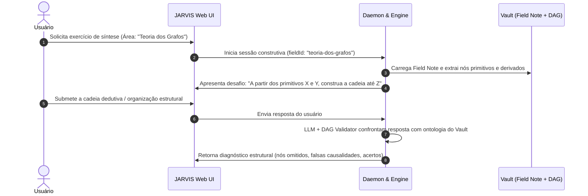

# RFC-003: Exercícios de Síntese Construtiva do Conhecimento (Bottom-Up Assembly)

* **Status:** `EM ANDAMENTO / RFC`
* **Autor:** zRhyan & JARVIS
* **Data de Criação:** 2026-10-21
* **Última Atualização:** 2026-10-21
* **Módulo Alvo:** `@jarvis/core`, `@jarvis/daemon`, `@jarvis/web`

---

## 1. Contexto e Motivação

Exercícios atômicos (como flashcards e quizzes) são excelentes para testar o domínio local de um nó específico da rede (ex: lembrar a definição de *Grafo Bipartido*). Contudo, eles falham em avaliar a **visão arquitetural e construtiva** do estudante sobre um campo de conhecimento inteiro.

Na sistematização adotada pelo usuário, existem notas de nível superior do tipo **Campo (`field`)**, que funcionam como o epicentro e agrupamento de uma área inteira através de um sumário temático estruturado.

A compreensão profunda de uma disciplina consiste em saber derivar o conhecimento a partir de seus fundamentos primitivos (axiomas e definições elementares), escalando em complexidade até os teoremas avançados e aplicações práticas.

---

## 2. Objetivos Principais

1. **Desafio de Reconstrução Epistêmica (Bottom-Up Assembly):**
   * O JARVIS seleciona uma nota do tipo `field` (ou um ramo temático substantivo).
   * O sistema expõe apenas os conceitos primitivos/fundamentais daquele campo.
   * O estudante é desafiado a encadear as derivações subsequentes:
     * Quais novos objetos são formulados sobre esses primitivos?
     * Quais teoremas/propriedades emergem dessas definições?
     * Onde o ramo se bifurca em subáreas coordenadas?

2. **Tipos de Exercícios Construtivos Propostos:**
   * **Reconstrução de Árvore Cega:** O usuário recebe uma lista desordenada de conceitos do campo e precisa organizá-los na ordem correta de pré-requisitos lógicos.
   * **Ponte Dedutiva (Bridging):** Dados dois conceitos distantes (ex: *Axioma da Escolha* e *Teorema de Tychonoff*), o estudante precisa articular o caminho de teoremas intermediários que conecta ambos.
   * **Dissertação Construtiva Macro:** O usuário escreve uma síntese estruturada da gênese da área, e o JARVIS avalia a precisão de cada transição lógica.

3. **Avaliação Automatizada da Cadeia Construtiva:**
   * O JARVIS compara a árvore mental montada pelo estudante com o DAG de conhecimento real do Vault (definido na RFC-002).
   * O sistema aponta lacunas estruturais: *"Você saltou diretamente da definição de Vértice para Grafo Conexo sem formalizar a existência de Arestas e Caminhos"*.

---

## 3. Fluxo de Execução do Exercício

---

## 4. Pontos em Aberto e Tópicos para Discussão (RFC)

1. **Formato de Resposta do Usuário:**
   * Deve ser um exercício visual interativo (ex: arrastar e soltar cartões conceituais em uma árvore no navegador)?
   * Deve ser em texto livre/dissertativo com o JARVIS realizando a extração e validação das relações lógicas?
   * Ou um formato híbrido (começar por texto e o JARVIS renderizar o grafo comparativo)?
2. **Critério de Abrangência de uma Field Note:**
   * Como dosar o escopo do exercício para não se tornar excessivamente exaustivo (ex: uma área com 80 notas)?
   * Estratégia de particionamento: testar sub-ramos ou "níveis de profundidade" de cada vez.
3. **Métricas de Sucesso:**
   * Como quantificar o domínio estrutural de um campo?
   * O resultado deste exercício deve recalibrar os intervalos do SRS de todas as notas filhas do ramo?
