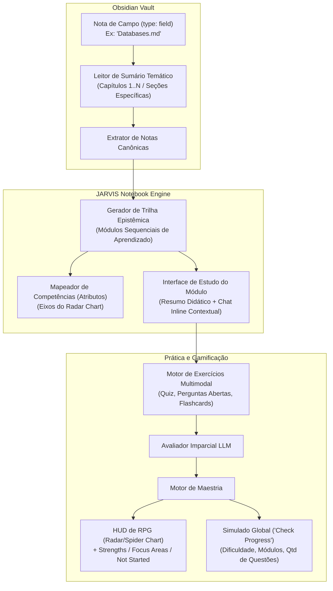

# RFC-005: Interactive Study Notebooks & RPG Mastery HUD (Notebook de Aprendizado Aprimorado)

* **Status:** `EM ANDAMENTO / RFC`
* **Autor:** zRhyan & JARVIS
* **Data de Criação:** 2026-10-23
* **Última Atualização:** 2026-10-23
* **Módulo Alvo:** `@jarvis/core`, `@jarvis/daemon`, `@jarvis/web`

---

## 1. Contexto e Motivação

Recentemente, o ecossistema Gemini introduziu os **Study Notebooks** (Cadernos de Estudo Orientados por IA). Essa ferramenta analisa materiais enviados (PDFs, Markdown, anotações de aula) e os estrutura em uma jornada de aprendizado dividida em módulos sequenciais, acompanhada de um dashboard de progresso que categoriza tópicos em:
1. **Strengths (Forças):** Tópicos onde o estudante demonstrou domínio com acertos sólidos em quizzes.
2. **Areas to Focus (Áreas para Focar):** Lacunas conceituais e erros detectados, gerando revisões e perguntas direcionadas.
3. **Not Started (Não Iniciado):** Conteúdo da trilha ainda não exercitado.
4. **Check Your Progress:** Simulados globais ou parciais parametrizáveis (seleção de módulos, 5/10/20 questões, dicas on/off).

### A Oportunidade no JARVIS: Superar o Modelo Padrão
Embora a mecânica do Gemini seja excelente, ela opera de forma isolada do ecossistema pessoal do usuário e se limita predominantemente a quizzes de múltipla escolha. 

No JARVIS, podemos criar um **Notebook** alimentado diretamente pelas notas canônicas do Obsidian Vault (especialmente notas do tipo `Field` e seus sumários temáticos), com:
* **Visualização Gamificada de HUD de RPG (Radar / Spider Chart):** Em vez de meros percentuais secos, os atributos do campo de conhecimento (ex: *Modelagem*, *Normalização*, *Álgebra Relacional*, *Transações ACID*) expandem visualmente conforme a maestria é alcançada.
* **Diversidade de Prática Ativa:** Incorporação de perguntas abertas corrigidas por IA, flashcards e desafios estruturais.
* **Granularidade Flexível de Escopo:** Geração de notebooks a partir de notas de campo inteiras ou apenas de capítulos/seções selecionadas do sumário temático.
* **Controle de Dificuldade:** Parametrização do nível cognitivo das questões (básico, intermediário, avançado/concurso/olimpíada).

---

## 2. Arquitetura do JARVIS Study Notebook

---

## 3. Componentes Principais da Experiência

### 3.1. Geração do Notebook a partir de Notas `field` (Campo)
O usuário pode solicitar via chat ou UI:
> *"JARVIS, crie um Notebook de Estudos para o campo **Banco de Dados**, cobrindo os Capítulos 1, 2 e 3 do sumário temático."*

1. **Varredura e Ingestão:** O JARVIS carrega a nota `field`, extrai a definição conceitual da área e localiza as notas correspondentes aos capítulos solicitados.
2. **Decomposição em Módulos:** O motor gera módulos lógicos estruturados (cada qual focado em um bloco coerente de conceitos).
3. **Eixos de Atributos do Campo:** O JARVIS identifica de 4 a 8 dimensões fundamentais daquele domínio para compor a **HUD de Radar**.

### 3.2. A Tela do Módulo (Study View)
Ao entrar em um módulo:
* **Exposição Didática:** Uma síntese estruturada gerada a partir das notas do Vault, destacando primitivos, teoremas e relações.
* **Chat Inline Especialista:** O usuário pode tirar dúvidas específicas do módulo sem perder o contexto da lição.
* **Desafio de Maestria:** Botão para iniciar a prática ativa (quizzes, perguntas abertas ou cartões conceituais).

### 3.3. A HUD de Maestria estilo RPG (Radar / Spider Chart)
Inspirado nas telas de status de jogos e no conceito de desenvolvimento de personagem:
* Um gráfico de teia circular onde cada vértice representa um atributo essencial daquele campo do saber.
* Conforme o estudante acerta exercícios e solidifica conceitos, os vértices se expandem do centro ($0\%$) para a borda ($100\%$).
* **Categorização Dinâmica de Tópicos:**
  * **Forças (Strengths):** Nós e atributos consolidados.
  * **Áreas para Focar (Focus Areas):** Questões erradas geram nós de revisão prioritária com explicações do porquê do erro.
  * **Não Iniciado (Not Started):** Módulos pendentes de avaliação.

### 3.4. O Simulador Personalizável ("Hora de Checar o Progresso")
A qualquer momento, o estudante pode configurar um simulado:
* **Escopo:** Seleção livre dos módulos (ex: todos ou subconjunto específico).
* **Quantidade de Questões:** 5, 10, 20 ou número customizado.
* **Modo Dicas:** Ativado (com dicas conceituais sob demanda) ou Desativado (exame puro).
* **Nível de Dificuldade:**
  * *Nível 1 (Fundamentação):* Definições diretas e exemplos canônicos.
  * *Nível 2 (Intermediário):* Aplicação prática, diferenciação de conceitos irmãos (*coordenados*).
  * *Nível 3 (Avançado / Concurso):* Casos de borda, contra-exemplos, demonstrações lógicas e pegadinhas clássicas.

---

## 4. Relação e Sinergia com as Outras RFCs

O Notebook de Estudos funciona como a **interface unificada de consumo** de várias outras RFCs:
* **Com a RFC-001 (Active Recall & SRS):** Utiliza o mesmo motor de geração de quizzes/perguntas abertas e o avaliador por LLM para mover itens entre *Focus Areas* e *Strengths*.
* **Com a RFC-002 (Epistemic DAG):** A ordem dos módulos e dos atributos da HUD é guiada pela relação de dependência (conceitos *Pressupostos* vêm nos módulos 1 e 2; *Derivados* vêm a seguir).
* **Com a RFC-003 (Síntese Construtiva):** O exame final de um Notebook pode ser um exercício de montagem estrutural da área.
* **Com a RFC-004 (Arena de Debate):** Possibilidade de desbloquear uma *Disputatio Escolástica* como "Desafio de Maestria / Boss Fight" ao atingir $80\%$ de força nos atributos.

---

## 5. Pontos em Aberto e Tópicos para Discussão (RFC)

1. **Persistência dos Notebooks:**
   * Onde armazenar o estado dos notebooks gerados e o histórico de progresso? 
   * Recomendação: Tabela dedicada no SQLite do daemon (`study_notebooks`, `notebook_modules`, `notebook_progress`), mantendo cache de notas lidas para não reprocessar o Vault a cada sessão.
2. **Biblioteca de Gráficos na Web UI (`packages/web`):**
   * Qual biblioteca adotar para renderizar o gráfico de radar/spider com a estética sci-fi/HUD do JARVIS (ex: Chart.js, Recharts, D3 ou Canvas customizado com efeito neon/cyberpunk coerente com o design do Stark)?
3. **Mecanismo de Recalibração de Forças:**
   * Uma força adquirida deve decair com o tempo se o usuário não praticar (integrando com a curva de esquecimento da repetição espaçada)?
   * Se sim, um vértice do gráfico de radar poderia regredir levemente após 30 dias sem revisão, sinalizando que o atributo precisa ser "recarregado".
4. **Notebooks Cruzados (Inter-field):**
   * No futuro, seria viável criar um notebook que conecte dois campos distintos (ex: *Cálculo Diferencial* + *Física Clássica*)?
