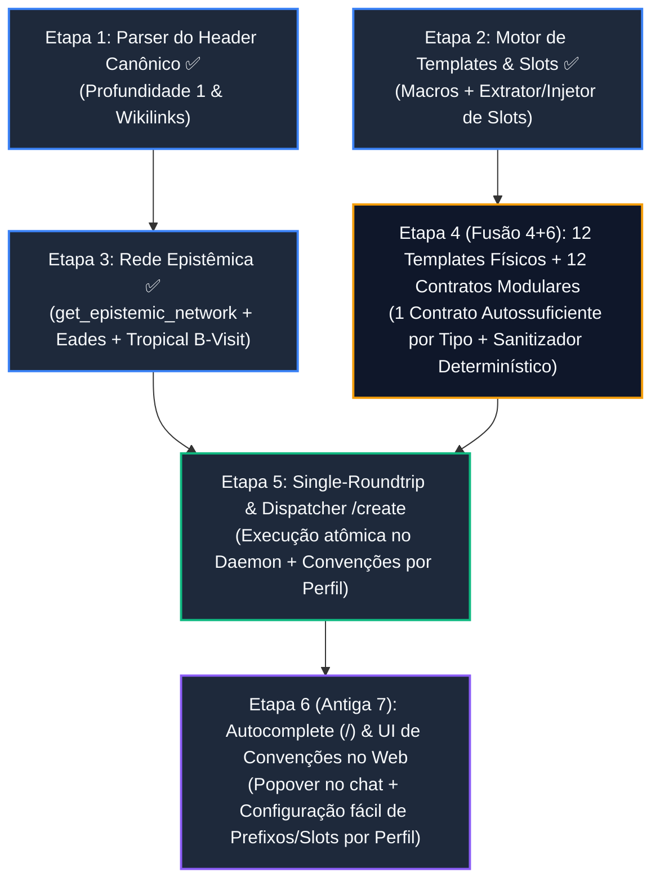

# RFC-008: Deterministic Template Engine, Epistemic Forest Resolution & Modular Rule Injection

* **Status:** `CONCLUÍDA ✅`
* **Autor:** zRhyan & JARVIS
* **Data de Criação:** 2026-10-26
* **Última Atualização:** 2026-11-03
* **Módulos Alvo:** `@jarvis/core`, `@jarvis/daemon`, `@jarvis/web`

---

## 1. Contexto e Motivação dos Problemas

A redação de notas pelo JARVIS apresentava quatro falhas fundamentais que comprometiam a integridade do cofre:
1. **Linguagem Falsamente Técnica & Prolixidade:** Jargões inflacionados e analogias vagas em substituição ao rigor formal e ontológico.
2. **Quebra da Composicionalidade Estrita:** A IA re-explicava a mecânica de primitivos já formalizados no cofre em vez de consumi-los como axiomas consolidados.
3. **Degradação da Estrutura Fixa (Slot Mutation):** Delegar à LLM a geração do Markdown fazia com que ela corrompesse cabeçalhos, apagasse marcadores e quebrasse convenções do Dataview e plugins de estudo (Spaced Repetition).
4. **Visão Plana do Grafo:** A ferramenta existente (`get_graph_neighborhood`) fornece apenas adjacências indiferenciadas de `outlinks` e `backlinks`, sem nenhuma compreensão da hierarquia causal/dedutiva por campo do saber.

---

## 2. Entregáveis Finais da RFC-008

Para que esta RFC seja considerada concluída, os seguintes entregáveis devem estar operacionais e testados:

* **[E1] Parser do Header Canônico de Taxonomia (`@jarvis/core`):** Leitor determinístico do bloco `## Map of Content / Tags:` em Markdown puro com profundidade 1 estrita, tolerância a singular/plural (`s?`) e suporte a derivações conjuntas (linhas únicas) e alternativas (múltiplas linhas).
* **[E2] Motor Determinístico de Templates & Injetor de Slots (`@jarvis/core`):** Leitor físico da pasta de templates configurável (default: `7 - Templates/`), compilador de macros (`{{date}}`, `{{time}}`, `<!--SR:...-->` a $D+3$) e substituição atômica de marcadores `<!-- SLOT:X -->` a partir de payload JSON.
* **[E3] Ferramenta da Rede Epistêmica (`get_epistemic_network` no `@jarvis/core` e `@jarvis/daemon`):** Nova primitiva baseada em Grafo Bipartido AIF e Teorias MMT que isola o subgrafo por `Domain Field`, computa níveis dinâmicos via Álgebra Tropical (conjunções $\max + 1$ nos $S$-nodes, disjunções $\min$ nos $I$-nodes, primitivos em nível $0$), mapeia âncoras externas (`boundaryAnchors`) e desfaz ciclos acidentais via heurística de Eades Bipartida garantindo corte exclusivo em arestas de conclusão $S \to I$ (preservando `get_graph_neighborhood` intacto para exploração geral). Especificação técnica completa detalhada na [RFC-002](file:///home/zrhyan/Principal/Computation/JARVIS/docs/rfcs/rfc-002-epistemic-dag-ontology.md).

* **[E4] Arquitetura Granular de 12 Contratos Autossuficientes (`SlotContract`), Templates Físicos Canônicos (`7 - Templates/`) & Sanitizador Determinístico (`@jarvis/core` + Cofre):** Fusão orgânica entre o desenho dos **12 templates físicos canônicos** (os 11 tipos ontológicos + `Field -`) e seus **12 módulos de contrato autossuficientes** (`packages/core/src/contracts/`). Cada tipo de nota possui seu próprio arquivo de contrato isolado contendo tanto as regras específicas do seu `Map of Content` quanto as diretrizes formais dos seus slots de corpo (incluindo o tratado completo de Espécies de Definição por Domínio A, B, C... e metadados explícitos renderizados na nota Markdown). Garante **custo mínimo de tokens** (a LLM carrega apenas 1 contrato por chamada `/create`) e inclui um **Sanitizador e Normalizador Determinístico Pós-LLM** (`slot-sanitizer.ts`) que formata conjunções ($E$) e disjunções ($OU$) na sintaxe exata da Etapa 1 e elimina cabeçalhos duplicados ou wikilinks malformados.
* **[E5] Pipeline Single-Roundtrip no Daemon com Comando `/create` (`@jarvis/daemon`):** Execução em 1 único turno de IA (resolução das convenções do perfil ativo + compilação do template físico + consulta da rede epistêmica do campo + injeção cirúrgica apenas do contrato do tipo de nota solicitado $\to$ inferência da LLM preenchendo os slots em JSON estruturado $\to$ sanitização determinística e gravação atômica). Suporte híbrido a comando tipado e linguagem natural com confirmação.
* **[E6] UI de Autocomplete Guiado (`/`) & Painel de Personalização de Convenções/Contratos por Perfil (`@jarvis/web`):** Menu popover no campo de chat acionado por `/` e interface de configuração por Perfil/Cofre permitindo ao usuário customizar facilmente o diretório de templates, os prefixos dos 12 tipos de nota e as diretrizes/regras de cada slot sem alterar código-fonte.

---

## 3. Ontologia Canônica dos 11 Tipos de Notas (+ `Field -`) & Modalidades Epistêmicas (Nível 2 / AIF)

Para mapear com perfeição o conhecimento em sistemas estritos (matemática/lógica), sistemas empíricos (física/ciências naturais), sistemas dialéticos (filosofia/teologia) e o estudo ativo (engenharia cognitiva), o JARVIS opera sobre **11 tipos de notas conceituais fundamentais** mais a nota estrutural de área (**`Field -`**), totalizando **12 arquétipos canônicos**.

Cada tipo possui um papel funcional claro, uma modalidade lógica formal no framework **ASPIC+ / AIF (Argument Interchange Format)**, um template físico dedicado e um contrato de slots exclusivo:

|   #    | Prefixo Padrão | Tipo Canônico              | Modalidade Lógica (ASPIC+ / AIF)                       | Função Epistêmica & Cognitiva                                                                                                      | Slots Essenciais Exigidos no Template (Definidos em conjunto com o Template Físico na Etapa 4)                  |
| :----: | :------------- | :------------------------- | :----------------------------------------------------- | :--------------------------------------------------------------------------------------------------------------------------------- | :-------------------------------------------------------------------------------------------------------------- |
| **1**  | `Axiom - `     | **Axioma / Postulado**     | Premissa Básica Inviolável ($\mathcal{K}_n$)           | Ponto de partida formal indemonstrável e autoevidente de um sistema dedutivo.                                                      | `<!-- SLOT:STATEMENT -->`, `<!-- SLOT:MOTIVATION -->` (+ slots de taxonomia MOC)                                |
| **2**  | `Def - `       | **Definição**              | Conjunção Semântica Estrita ($R_s$)                    | Fixação essencial, genética/construtiva, operacional ou nominal conforme o Domínio Epistêmico (A, B, C...), com metadados explícitos na nota. | Metadados explícitos de Domínio/Espécie + `<!-- SLOT:FORMAL_DEFINITION -->`, `<!-- SLOT:ELUCIDATION -->`, `<!-- SLOT:ELEMENTS -->` |
| **3**  | `Theo - `      | **Teorema / Proposição**   | Dedução Estrita Necessária ($R_s$)                     | Proposição formal acompanhada de demonstração dedutiva incontestável ($Q.E.D.$). Abriga seus corolários diretos.                   | `<!-- SLOT:STATEMENT -->`, `<!-- SLOT:PROOF -->`, `<!-- SLOT:COROLLARIES -->`                                   |
| **4**  | `Conj - `      | **Conjectura**             | Proposição Sob Investigação Formal ($R_d$ transitório) | Proposição matemática com farta evidência computacional/particular, mas que carece de demonstração dedutiva geral.                 | `<!-- SLOT:STATEMENT -->`, `<!-- SLOT:SUPPORTING_EVIDENCE -->`, `<!-- SLOT:KNOWN_BOUNDS -->`                    |
| **5**  | `Obs - `       | **Observação / Evidência** | Premissa de Fato Empírica ($\mathcal{K}_p$)            | Registro de medições empíricas brutas, dados de experimentos, eventos observados na realidade.                                     | `<!-- SLOT:DATA_STATEMENT -->`, `<!-- SLOT:CONTEXT_CONDITIONS -->`, `<!-- SLOT:METHODOLOGY -->`                 |
| **6**  | `Law - `       | **Lei Empírica**           | Princípio Físico / Regra Derrotável ($R_d$)            | Relação funcional invariante induzida de observações que atua como base dedutiva local derrotável nas ciências naturais.           | `<!-- SLOT:LAW_STATEMENT -->`, `<!-- SLOT:FORMULA -->`, `<!-- SLOT:EMPIRICAL_LIMITS -->`                        |
| **7**  | `Hyp - `       | **Hipótese**               | Conjectura Científica Explicativa ($R_d$)              | Proposição preliminar formulada para explicar fenômenos e gerar predições que serão testadas por observações (`Obs - `).           | `<!-- SLOT:HYPOTHESIS_STATEMENT -->`, `<!-- SLOT:TESTABLE_PREDICTIONS -->`, `<!-- SLOT:PROPOSED_EXPERIMENT -->` |
| **8**  | `Tese - `      | **Tese**                   | Asserção Justificada / Doutrina ($R_d$)                | Posição filosófica, teológica ou teórica afirmada e defendida por um autor com rede articulada de argumentos.                      | `<!-- SLOT:THESIS_STATEMENT -->`, `<!-- SLOT:ARGUMENTATION -->`, `<!-- SLOT:IMPLICATIONS -->`                   |
| **9**  | `Obj - `       | **Objeção**                | Nó de Conflito Dialético ($CA$-node)                   | Ataque formal que refuta (*rebutting*), solapa a inferência (*undercutting*) ou mina as premissas (*undermining*) de uma tese/lei. | `<!-- SLOT:TARGET_CONCEPT -->`, `<!-- SLOT:OBJECTION_ARGUMENT -->`, `<!-- SLOT:COUNTER_EVIDENCE -->`            |
| **10** | `Quest - `     | **Questão / Quaestio**     | Inquérito Racional / Síntese Dialética (IBIS / Issue)  | Investigação motivada por uma pergunta central que contrasta conceitos coordenados, revelando quebras de invariantes e trade-offs. | `<!-- SLOT:CENTRAL_QUESTION -->`, `<!-- SLOT:COMPARATIVE_ANALYSIS -->`, `<!-- SLOT:TRADEOFF_SYNTHESIS -->`      |
| **11** | `Prat - `      | **Prático**                | Conhecimento Procedural / Operacional                  | Diretrizes de implementação no mundo real, código de software, arquitetura, boas práticas de engenharia e armadilhas.              | `<!-- SLOT:PRACTICAL_GUIDELINES -->`, `<!-- SLOT:IMPLEMENTATION_CODE -->`, `<!-- SLOT:PITFALLS -->`             |
| **12** | `Field - `     | **Campo / Área (MOC)**     | Teoria Modular MMT ($\Sigma$)                          | Mapa de conteúdo estrutural de uma área do conhecimento, delimitando escopo, subáreas, objetos centrais e maquinário.              | Slots de Taxonomia de Área (`BROADER`, `COORDINATE_FIELDS`, `NARROWER`, `CORE_OBJECT`, `MACHINERY`) + Sumário   |

---

## 4. Arquitetura de Mapeamento e Personalização por Perfil do Cofre (Profile-Aware Engine)

O JARVIS adota estritamente a relação **1 Perfil = 1 Cofre do Obsidian**. Enquanto a **ontologia de 12 tipos canônicos e suas modalidades lógicas no grafo AIF são invariantes do motor**, toda a camada de nomenclatura e diretrizes de escrita é personalizável por Perfil para que qualquer usuário possa adaptar o JARVIS ao seu cofre com facilidade:

### 4.1. Separação entre Invariantes do Motor vs Personalizações do Perfil
1. **Invariantes do Sistema (Fixos no Motor):**
   - Os 12 arquétipos canônicos (`axiom`, `definition`, `theorem`, `conjecture`, `observation`, `law`, `hypothesis`, `thesis`, `objection`, `quaestio`, `practical`, `field`) e seu comportamento algébrico no Grafo Bipartido AIF e nos Grafos de Teorias MMT.
   - A sintaxe determinística de conjunção (mesma linha) e disjunção (linhas separadas) no `Map of Content`.
2. **Elementos Personalizáveis por Perfil/Cofre (Configuráveis via UI / JSON do Perfil):**
   - **Diretório de Templates (`templatesDir`):** Nome da pasta onde residem os templates no cofre (default: `"7 - Templates"`).
   - **Prefixos Personalizados por Tipo (`prefix`):** Ex: usar `"Prat - "` ou `"Prac - "` para notas práticas, `"Def - "` ou `"Definição - "` para definições.
   - **Arquivo de Template Associado (`templateFile`):** Nome do arquivo `.md` dentro de `templatesDir` para cada um dos 12 tipos.
   - **Overrides de Regras de Slots (`slotRuleOverrides`):** Possibilidade de o usuário visualizar e customizar as diretrizes de redação de qualquer slot em cada tipo de nota.

### 4.2. Schema `VaultConventionsConfig` e Defaults Canônicos de Fábrica
No `@jarvis/core` e `@jarvis/daemon`, a resolução de tipos de notas, templates e overrides de regras é mediada por `VaultConventionsConfig`:

```typescript
export interface NoteTypeConfig {
  prefix: string;                   // ex: "Def - ", "Prac - "
  templateFile: string;             // ex: "Def - Template.md"
  canonicalType: CanonicalNoteType; // "definition", "theorem", "quaestio", etc.
  modality: 'strict' | 'defeasible' | 'inviolable_premise' | 'empirical_premise' | 'conflict' | 'inquiry' | 'procedural' | 'theory_module';
  slotRuleOverrides?: Record<string, string>; // Overrides opcionais do usuário por slotId
}

export interface VaultConventionsConfig {
  templatesDir: string;             // default: "7 - Templates"
  noteTypes: Record<Exclude<CanonicalNoteType, 'generic'>, NoteTypeConfig>;
}
```

Se o perfil ativo não sobrescrever valores específicos, o sistema aplica imediatamente os **Defaults Canônicos de Fábrica**:
* `templatesDir`: `"7 - Templates"`
* `axiom` $\to$ Prefix: `"Axiom - "`, Template: `"Axiom - Template.md"`
* `definition` $\to$ Prefix: `"Def - "`, Template: `"Def - Template.md"`
* `theorem` $\to$ Prefix: `"Theo - "`, Template: `"Theo - Template.md"`
* `conjecture` $\to$ Prefix: `"Conj - "`, Template: `"Conj - Template.md"`
* `observation` $\to$ Prefix: `"Obs - "`, Template: `"Obs - Template.md"`
* `law` $\to$ Prefix: `"Law - "`, Template: `"Law - Template.md"`
* `hypothesis` $\to$ Prefix: `"Hyp - "`, Template: `"Hyp - Template.md"`
* `thesis` $\to$ Prefix: `"Tese - "`, Template: `"Tese - Template.md"`
* `objection` $\to$ Prefix: `"Obj - "`, Template: `"Obj - Template.md"`
* `quaestio` $\to$ Prefix: `"Quest - "`, Template: `"Quest - Template.md"`
* `practical` $\to$ Prefix: `"Prat - "`, Template: `"Prat - Template.md"`
* `field` $\to$ Prefix: `"Field - "`, Template: `"Field - Template.md"`

---

## 5. Visão Geral da Arquitetura & Roadmap Consolidado (Fusão das Antigas Etapas 4 e 6)

> **Decisão Arquitetural de Consolidação:** Como os contratos de slots (`SlotContract`) e os templates físicos (`7 - Templates/*.md`) são duas faces da mesma moeda (cada slot do contrato corresponde a um marcador `<!-- SLOT:X -->` de um template específico), a antiga **Etapa 6 (Especialização dos Templates Físicos)** foi **fundida na Etapa 4**. Assim, construímos os 12 templates físicos e seus 12 contratos modulares autossuficientes em conjunto antes de implementar o orquestrador `/create` na Etapa 5.



### Síntese das Etapas:

| Etapa | Foco Principal | Módulo | Dependência Direta | Status |
| :---: | :--- | :---: | :---: | :---: |
| **Etapa 1** | Parser de Header Canônico (Profundidade 1, Conjunções e Disjunções) | `@jarvis/core` | Nenhuma | `CONCLUÍDA ✅` |
| **Etapa 2** | Motor de Templates Determinístico & Injeção de Slots | `@jarvis/core` | Nenhuma | `CONCLUÍDA ✅` |
| **Etapa 3** | Algoritmo da Rede Epistêmica (`get_epistemic_network` Bipartite AIF) | `@jarvis/core`, `@jarvis/daemon` | Etapa 1 | `CONCLUÍDA ✅` |
| **Etapa 4** *(Fusão 4+6)* | **Os 12 Templates Físicos Canônicos (`7 - Templates/`) + Os 12 Contratos Modulares Autossuficientes de Slots + Sanitizador Pós-LLM** | Cofre (Vault) + `@jarvis/core` | Etapa 2 | `CONCLUÍDA ✅` |
| **Etapa 5** | Dispatcher Tipado `/create` em Single-Roundtrip & Persistência de `VaultConventionsConfig` por Perfil | `@jarvis/daemon` | Etapas 2, 3 e 4 | `CONCLUÍDA ✅` |
| **Etapa 6** *(Antiga 7)* | Autocomplete Guiado (`/`) no Chat & Painel de Configuração de Convenções/Slots por Perfil | `@jarvis/web` | Etapa 5 | `CONCLUÍDA ✅` |

---

## 6. Detalhamento Passo a Passo das Etapas

### Etapa 1: Parser do Header Canônico de Taxonomia (Profundidade 1) — `CONCLUÍDA ✅`
* **Objetivo:** Extrair deterministicamente as conexões ontológicas locais a partir do corpo em Markdown puro das notas, tratando conjunções ($E$) em linha única e alternativas disjuntivas ($OU$) em múltiplas linhas, preservando os wikilinks nativos clicáveis no Obsidian.
* **Entregáveis Específicos:**
  - `packages/core/src/epistemic-header-parser.ts`: Funções para ler e serializar o bloco `## Map of Content / Tags:` com suporte tolerante a rótulos no singular ou plural (`Domain Field(s)`, `Presupposed Concept(s)`, `Coordinate Concept(s)`, `Derived Concept(s)`, `Related (Concepts)`).
  - Tipos estruturados em `packages/core/src/epistemic-header-parser.ts`:
    ```typescript
    export interface EpistemicDerivationPath {
      isConjunction: boolean;       // true se múltiplos conceitos na mesma linha (A e B)
      prerequisites: string[];      // ["Def - Vértice", "Def - Aresta"]
    }

    export interface EpistemicHeader {
      hasHeader: boolean;
      tags: string[];
      status?: string;
      domainFields: string[];       // ex: ["Logic", "Scholasticism"]
      presupposedPaths: EpistemicDerivationPath[]; // Linhas independentes = caminhos alternativos (OU)
      coordinate: string[];         // Irmãos diretos
      derived: string[];            // Filhos diretos (profundidade 1)
      related: string[];
      rawHeader?: string;
    }
    ```
  - Testes unitários cobrindo (`12/12` aprovados em `test/epistemic-header-parser.test.ts`):
    1. Linha única com múltiplos links: `[[A]], [[B]]` $\to$ Conjunção $A \land B \vdash C$.
    2. Sub-itens em linhas múltiplas $\to$ Disjunção $(A \land B) \lor D \vdash C$.
    3. Normalização de wikilinks com aliases (`[[Nota|Alias]]` $\to$ chave canônica `"Nota"`).
    4. Tolerância a singular/plural nos rótulos e notas sem cabeçalho completo.

---

### Etapa 2: Motor Determinístico de Templates & Injeção de Slots (O QuickAdd do JARVIS) — `CONCLUÍDA ✅`
* **Objetivo:** Garantir que o esqueleto estrutural de uma nova nota nasça por código local, e que a LLM apenas preencha slots demarcados sem tocar na estrutura.
* **Entregáveis Específicos:**
  - `packages/core/src/template-engine.ts`:
    - Leitor da pasta física de templates configurada no perfil (default: `7 - Templates/`).
    - Expansor determinístico de macros: `{{date}}`, `{{time}}`, `{{title}}` e Spaced Repetition (`<!--SR:YYYY-MM-DD,3,250-->` calculada como data local $D+3$).
    - Extrator de marcadores `<!-- SLOT:NOME_DO_SLOT -->`.
    - Injetor de slots: substitui os marcadores pelo payload JSON correspondente.
  - Testes unitários validando a integridade dos esqueletos de `Def - Template.md` e `Quest - Template.md` (`12/12` aprovados em `test/template-engine.test.ts`).

---

### Etapa 3: Algoritmo da Rede Epistêmica por Campo (`get_epistemic_network`) — `CONCLUÍDA ✅`
> **Especificação Executiva Completa e Relatório de Implementação:** Ver [RFC-002: Epistemic Network Engine](file:///home/zrhyan/Principal/Computation/JARVIS/docs/rfcs/rfc-002-epistemic-dag-ontology.md).
* **Objetivo:** Prover uma ferramenta independente de inspeção ontológica que modela o cofre como um Grafo Bipartido AIF e Grafo de Teorias MMT, isola o subgrafo induzido pelo campo consultado, calcula níveis topológicos via Álgebra Tropical e resolve ciclos preservando esquemas conjuntivos. Mantém `get_graph_neighborhood` inalterado para buscas genéricas de links.
* **Resumo da Conclusão das Implementações (Sub-etapas 3.1 a 3.6):**
  1. **Sub-etapa 3.1 (`epistemic-uri.ts`):** Implementado `MMTUriResolver` com prefixo canônico `jarvis://vault?mod?sym`, regex compatível com Unicode e espaços (`/^[^\x00-\x1F?#]+$/u`), endereçamento de sub-símbolos `S-Nodes` (`$ra_k`, `$ca_k`, `$pa_k`) e resolução contextual de Wikilinks (`resolveWikilink` / `resolveRelative`) com detecção automática de multihoming, importação inter-domínio e links fantasmas (`isPlaceholder: true`). Validado por `test/epistemic-uri.test.ts` (`8/8` testes).
  2. **Sub-etapa 3.2 (`epistemic-types.ts`, `epistemic-network.ts`, `epistemic-repo.ts`, `db.ts`):** Implementado `EpistemicAIFEngine` 100% em RAM no `@jarvis/core` (proibição estrita de arestas diretas $I \to I$ e $S \to S$, contadores $O(1)$ intra/inter-domínio e `boundaryCutIndex` de 32 bits), compilador `compileVaultToEpistemicEngine` (prioridade autoritativa de `Presupposed Concept(s)` sobre `Derived Concept(s)` evitando curto-circuito de conjunções, isolamento de `CA-Nodes` para `Obj - ` e extração limpa de `markdownExcerpt` via `extractCleanBodyExcerpt`) e persistência SQLite (`WITHOUT ROWID` escopada por `profile_id` com hashes SHA-256 truncados de 16 bytes) em `EpistemicRepository` no `@jarvis/daemon`. Validado por `test/epistemic-bipartite.test.ts` (`6/6`) e `test/epistemic-repo.test.ts` (`2/2`).
  3. **Sub-etapa 3.3 (`epistemic-cycle-breaker.ts`):** Implementados `computeNonTrivialSCCs` (Tarjan sobre arestas dedutivas com $|C| \ge 2$) e `breakCyclesEadesBipartite` (heurística de Eades com listas duplamente encadeadas de buckets indexados por $\delta(u)$, prioridade de partição $V_I \succ V_S$ e **Transferência Invariante B-Hipergrafo** que redireciona qualquer corte $I \to S$ para a única aresta de conclusão $S \to I_c$), garantindo que 100% do `feedbackArcSet` seja composto por arestas $S \to I$ e gerando `cycleWarnings` detalhados. Validado por `test/epistemic-cycle-breaker.test.ts` (`4/4`).
  4. **Sub-etapa 3.4 (`epistemic-tropical-sort.ts`):** Implementados `computeTropicalBVisitLevels` e `buildAcyclicEpistemicProjection` sobre buffers contíguos `Int32Array` (`dagInDeg`, `levels`, `kahnQueue`), aplicando Base Zero ($\mathcal{L} = 0$) para primitivos locais, Multiplicação Tropical ($\max + 1$) nos `S-Nodes` conjuntivos e Adição Tropical ($\min + 0$) nos `I-Nodes` derivados, executando em poucos milissegundos para grafos de $7.900+$ nós. Validado por `test/epistemic-tropical-sort.test.ts` (`5/5`).
  5. **Sub-etapa 3.5 (`epistemic-boundary.ts`):** Implementados `inspectDomainBoundary`, `extractInclusionMorphism` e `listIncomingInclusionMorphisms`, classificando `absoluteLocalPrimitives`, `externallyGroundedPrimitives`, `exportedBoundaryAnchors`, `importedBoundaryAnchors` e `externalPremiseNodes` em $O(|V_{\text{domínio}}|)$ e extraindo pontes cirúrgicas ($\Sigma_{\text{src}} \hookrightarrow \Sigma_{\text{dst}}$) sem achatar o cofre (*zero eager flattening*). Validado por `test/epistemic-boundary.test.ts` (`4/4`).
  6. **Sub-etapa 3.6 (`epistemic-prompt-builder.ts`, `tool-registry.ts`, `tool-executor.ts`, `vault-context.ts`, `vault-watcher.ts`):** Implementados `queryEpistemicNetwork`, `buildLLMContextForNote`, `buildLLMContextForDomain` e a tool `get_epistemic_network` no `@jarvis/daemon` operando tanto em **Modo Conceito** (cone reverso estratificado + âncoras externas) quanto em **Modo Campo** (árvore completa do domínio mesmo quando `targetNote` ainda não existe em disco, preparando o terreno para o comando `/create` da Etapa 5), com sincronização reativa automática no `VaultContext`, `VaultWatcherService` e `ToolExecutor`. Validado por `test/epistemic-network-tool.test.ts` (`5/5`).
  - **Resultado Global de Testes após a Etapa 3:** **19 suítes / 120 testes passando (`100%`)** (`73/73` em `@jarvis/core` e `47/47` em `@jarvis/daemon`).

---

### Etapa 4 (Fusão das Antigas Etapas 4 e 6): Especialização dos 12 Templates Físicos Canônicos (`7 - Templates/`) & Os 12 Contratos Modulares Autossuficientes de Slots + Sanitizador Pós-LLM (`@jarvis/core`) — `CONCLUÍDA ✅`
* **Objetivo:** Desenhar em conjunto os **12 arquivos físicos de templates** (no cofre) e os **12 módulos de contratos de slots autossuficientes** (no `@jarvis/core`), garantindo alinhamento 1:1 entre os marcadores `<!-- SLOT:X -->` de cada template e as regras epistêmicas/sintáticas exigidas da LLM, com **economia máxima de tokens** (carregamento seletivo de apenas 1 contrato por chamada) e **sanitização determinística pós-LLM**.
* **Arquitetura e Decisões Técnicas Consolidadas:**
  1. **Granularização Estrita em 12 Contratos Autossuficientes (`packages/core/src/contracts/`):**
     - Em vez de um arquivo monolítico que poluiria a janela de contexto da LLM, cada um dos 12 tipos canônicos possui seu próprio módulo isolado e autossuficiente (contendo tanto as diretrizes específicas do seu `Map of Content` quanto as regras formais dos slots do seu corpo):
       1. `contracts/axiom-contract.ts` $\leftrightarrow$ `7 - Templates/Axiom -.md`
       2. `contracts/definition-contract.ts` $\leftrightarrow$ `7 - Templates/Def -.md`
       3. `contracts/theorem-contract.ts` $\leftrightarrow$ `7 - Templates/Theo -.md`
       4. `contracts/conjecture-contract.ts` $\leftrightarrow$ `7 - Templates/Conj -.md`
       5. `contracts/observation-contract.ts` $\leftrightarrow$ `7 - Templates/Obs -.md`
       6. `contracts/law-contract.ts` $\leftrightarrow$ `7 - Templates/Law -.md`
       7. `contracts/hypothesis-contract.ts` $\leftrightarrow$ `7 - Templates/Hyp -.md`
       8. `contracts/thesis-contract.ts` $\leftrightarrow$ `7 - Templates/Tese -.md`
       9. `contracts/objection-contract.ts` $\leftrightarrow$ `7 - Templates/Obj -.md`
       10. `contracts/quaestio-contract.ts` $\leftrightarrow$ `7 - Templates/Quest -.md`
       11. `contracts/practical-contract.ts` $\leftrightarrow$ `7 - Templates/Prac -.md`
       12. `contracts/field-contract.ts` $\leftrightarrow$ `7 - Templates/Field -.md`
     - Quando o agente vai redigir uma nota (ex: um `theorem`), o montador de prompt carrega **única e exclusivamente** `theorem-contract.ts`, mantendo custo zero de tokens para os outros 11 tipos.
  2. **Explicitação na Nota Markdown do Domínio e Espécie de Definição (Opção 3B):**
     - No contrato e template de `Def -` (`definition-contract.ts`), as diferentes **Espécies de Definição** são organizadas por **Domínios Epistêmicos** (Domínio A: Conceitos Filosóficos/Ontológicos; Domínio B: Matemática, Lógica Formal e Ciência da Computação; Domínio C: Ciências Empíricas, Engenharia Experimental e Psicometria; etc.).
     - A IA deve explicitar diretamente nos slots renderizados na nota Markdown qual Domínio Epistêmico está tratando, qual Espécie de Definição daquele domínio utilizou e seguir rigorosamente a estrutura formal exigida por aquela espécie.
  3. **Normalizador e Sanitizador Determinístico Pós-LLM (`contracts/slot-sanitizer.ts`):**
     - **Formatação Determinística do MOC (`PRESUPPOSED`, `COORDINATE`, `DERIVED`, `RELATED`):** Converte e normaliza as entradas de conjunção ($E$, múltiplos wikilinks na mesma linha) e disjunção ($OU$, sub-bullets em linhas separadas com indentação exata) para garantir 100% de compatibilidade com o `parseEpistemicHeader` da Etapa 1 e com a Rede Epistêmica da Etapa 3.
     - **Anti-Corrupção de Slots:** Remove cabeçalhos Markdown (`## ...`) duplicados caso a LLM os repita no início do conteúdo de um slot, e limpa wikilinks que contenham caminhos de diretórios ou `.md` (`[[Pasta/Nota.md]]` $\to$ `[[Nota]]`).
  4. **Catálogo Default de Convenções (`contracts/vault-conventions.ts`):**
     - Implementa `DEFAULT_VAULT_CONVENTIONS: VaultConventionsConfig` e resolvedores que aceitam overrides personalizados por Perfil (pasta de templates, prefixos dos 12 tipos e overrides de regras de slots).
  - **Validado por:** `test/slot-contracts-and-sanitizer.test.ts` (`6/6` testes passando, totalizando `79/79` em `@jarvis/core`).

---

### Etapa 5: Pipeline Single-Roundtrip no Daemon com Comando `/create` & Persistência de Convenções por Perfil — `CONCLUÍDA ✅`
* **Objetivo:** Unificar todo o fluxo de criação de notas em **uma única inferência de LLM (Single-Turn)** no `@jarvis/daemon`, persistindo as convenções/overrides do perfil ativo e utilizando os 12 templates físicos e contratos modulares construídos na Etapa 4.
* **Entregáveis Específicos:**
  - `packages/daemon/src/note-creator.ts`: Orquestrador que:
    1. Resolve o perfil ativo e suas convenções (`VaultConventionsConfig`, aplicando eventuais overrides de prefixos, pasta de templates ou regras de slots do perfil).
    2. Lê o template físico correspondente ao tipo da nota e compila as macros (`{{date}}`, `{{time}}`, `<!--SR:...-->`) via `TemplateEngine`.
    3. Executa `get_epistemic_network` (em **Modo Campo** sobre o `domainField` alvo quando a nota ainda não existe, ou em **Modo Conceito** caso já exista como placeholder/stub) para obter a árvore estratificada de primitivos, ancestrais e `boundaryAnchors`.
    4. Carrega **exclusivamente** o contrato modular daquele tipo de nota (injetando apenas as regras dos slots presentes no template físico).
    5. Chama o provedor LLM solicitando o payload JSON estruturado dos slots.
    6. Passa o payload pelo **Sanitizador Determinístico Pós-LLM** (`slot-sanitizer.ts`), injeta nos marcadores do esqueleto Markdown, grava atomicamente no cofre e atualiza o `GraphIndex` e o `EpistemicAIFEngine`.
  - Suporte ao comando tipado: `/create note: "Grafo Conexo" type: "definition" field: "[[Teoria dos Grafos]]"`.
  - Suporte ao modo linguagem natural com as tools `get_note_slot_contract` e `create_note_from_template` no loop agêntico e endpoints REST `GET/PUT /api/profiles/:id/conventions`.
  - **Validado por:** `test/note-creator-etapa5.test.ts` e `test/tool-registry.test.ts` (`50/50` testes passando em `@jarvis/daemon`).

---

### Etapa 6 (Antiga Etapa 7): UI de Autocomplete Guiado (`/`) & Painel de Personalização de Convenções/Slots por Perfil no Web UI — `CONCLUÍDA ✅`
* **Objetivo:** Acelerar a digitação de comandos tipados no chat e permitir que qualquer usuário personalize facilmente os prefixos, pasta de templates e regras de slots de cada Perfil/Cofre diretamente na interface Web (`@jarvis/web`).
* **Entregáveis Específicos:**
  - **Popover de Autocomplete (`/`) no Chat (`SlashCommandPopover.tsx` + `MessageInput.tsx`):** Acionado pelo caractere `/` ou botão `/create`, com navegação por teclado (setas/`Enter`/`Tab`/`Esc`) e mouse, preenchendo o esqueleto `/create note: "" type: "<archetype>" field: "[[Field - ]]"` com os 12 tipos canônicos e posicionando o cursor dentro de `note: ""`.
  - **Painel de Configuração de Convenções e Contratos por Perfil (`ConventionsModal.tsx`):** Interface amigável nas configurações do perfil onde o usuário pode alterar o nome da pasta de templates (`templatesDir`), customizar os prefixos e templates dos 12 tipos de nota e visualizar/editar as diretrizes de redação de cada slot (`<!-- SLOT:X -->`).
  - **Validado por:** `test/etapa6-conventions-and-slash.test.ts` (`4/4` testes novos passando, totalizando `16/16` em `@jarvis/web` e **145/145** no monorepo completo).

---

## 7. Matriz de Resoluções Canônicas (Fonte de Verdade)

| # | Problema / Tópico | Status | Resolução Arquitetural Oficial |
| :---: | :--- | :---: | :--- |
| **1** | **Falsa Raiz / Nó Órfão** | `RESOLVIDO (LEVE)` | Validação sintática local no daemon; impacto baixo mitigado por preenchimento por contrato. |
| **2** | **Relatividade do Nível por Campo** | `RESOLVIDO DEFINITIVO` | Função dinâmica: $Nível = f(Nota, Campo)$ calculada na rede epistêmica (primitivos em nível $0$, conjunções $\max+1$, disjunções $\min$); nunca gravada como coluna estática. |
| **3** | **Ponto Cego da Fronteira Externa** | `RESOLVIDO DEFINITIVO` | Nós de Nível 0 que dependem de conceitos externos expõem `boundaryAnchors` passadas como premissas ontológicas à LLM. |
| **4** | **Ciclos Epistêmicos Acidentais** | `RESOLVIDO DEFINITIVO` | Adotada a **Opção B**: detecção algorítmica (Tarjan SCC + Heurística de Eades Bipartida com invariante de corte exclusivo $S \to I$), rebaixamento temporário da aresta de conclusão para não travar o cálculo e emissão de alerta diagnóstico. |
| **5** | **Identificação do Campo (`Domain Field`)** | `RESOLVIDO DEFINITIVO` | Extração determinística da linha `- **Domain Field(s)**: [[Campo 1]], [[Campo 2]]` no header. Suporta pertinência múltipla (1:N e N:N) e fallback `__unassigned__`. |
| **6** | **Links Fantasmas (Notas Não Criadas)** | `RESOLVIDO DEFINITIVO` | Links não resolvidos em `Presupposed Concept` recebem `isPlaceholder: true` e herdam o campo pai para não distorcer os níveis do DAG. |
| **7** | **Fonte da Verdade: Markdown vs YAML** | `RESOLVIDO DEFINITIVO` | **Markdown puro no header** (`## Map of Content / Tags:`) para preservar navegação por clique nos wikilinks. Parser determinístico no `@jarvis/core`. |
| **8** | **Isolamento de Slots & Sanitização Pós-LLM** | `RESOLVIDO DEFINITIVO` | A LLM nunca redige o esqueleto Markdown. Ela devolve payload JSON, o `slot-sanitizer.ts` normaliza conjunções/disjunções, remove cabeçalhos duplicados e limpa wikilinks, e o daemon injeta atomicamente nos marcadores `<!-- SLOT:X -->`. |
| **9** | **Preservação de `get_graph_neighborhood`** | `RESOLVIDO DEFINITIVO` | `get_graph_neighborhood` permanece intacto para exploração geral de conexões. A rede epistêmica nasce como ferramenta nova: `get_epistemic_network`. |
| **10** | **UX de Disparo Universal** | `RESOLVIDO DEFINITIVO` | Híbrido universal (comando tipado primário + texto livre mapeado) com popover de autocomplete via `/` na UI. |
| **11** | **Ontologia Canônica de 12 Tipos & 12 Contratos Granulares** | `RESOLVIDO DEFINITIVO` | Aprovados os 11 tipos conceituais canônicos + `Field -` (12 tipos), cada um com seu próprio arquivo de template físico e seu próprio módulo de contrato autossuficiente (1:1), carregado seletivamente para economia máxima de tokens. |
| **12** | **Fusão das Antigas Etapas 4 e 6** | `RESOLVIDO DEFINITIVO` | Os 12 templates físicos (`7 - Templates/*.md`) e os 12 contratos de slots (`packages/core/src/contracts/`) são construídos juntos na **Etapa 4**, garantindo alinhamento perfeito de slots antes do pipeline `/create` (Etapa 5). |
| **13** | **Metadados Explícitos de Definição na Nota (Opção 3B)** | `RESOLVIDO DEFINITIVO` | Nas notas de definição (`Def -`), o Domínio Epistêmico (A, B, C...) e a Espécie de Definição escolhida são explicitados diretamente nos slots renderizados na nota Markdown. |
| **14** | **Configurabilidade Fácil por Perfil no Web UI** | `RESOLVIDO DEFINITIVO` | Os 12 arquétipos são invariantes do motor, mas a pasta de templates, os prefixos de cada tipo e os overrides de regras de cada slot são personalizáveis por Perfil/Cofre via `VaultConventionsConfig` e painel dedicado no Web UI. |

