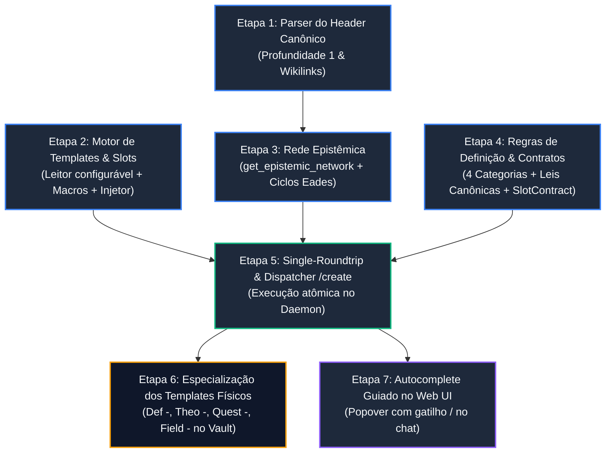

# RFC-008: Deterministic Template Engine, Epistemic Forest Resolution & Modular Rule Injection

* **Status:** `EM ANDAMENTO / RFC`
* **Autor:** zRhyan & JARVIS
* **Data de Criação:** 2026-10-26
* **Última Atualização:** 2026-10-28
* **Módulos Alvo:** `@jarvis/core`, `@jarvis/daemon`, `@jarvis/web`

---

## 1. Contexto e Motivação dos Problemas

A redação de notas pelo JARVIS apresentava quatro falhas fundamentais que comprometiam a integridade do cofre:
1. **Linguagem Falsamente Técnica & Prolixidade:** Jargões inflacionados e analogias vagas em substituição ao rigor formal e ontológico.
2. **Quebra da Composicionalidade Estrita:** A IA re-explicava a mecânica de primitivos já formalizados no cofre em vez de consumi-los como axiomas consolidados.
3. **Degradação da Estrutura Fixa (Slot Mutation):** Delegar à LLM a geração do Markdown fazia com que ela corrompesse cabeçalhos, apagasse marcadores e quebrasse convenções do Dataview e plugins de estudo (Spaced Repetition).
4. **Visão Plana do Grafo:** A ferramenta existente (`get_graph_neighborhood`) fornece apenas adjacências indiferenciadas de `outlinks` e `backlinks`, sem nenhuma compreensão da hierarquia causal/dedutiva por campo do saber.

---

## 2. Entregáveis Finais da RFC-008

Para que esta RFC seja considerada concluída, os seguintes entregáveis devem estar operacionais e testados:

* **[E1] Parser do Header Canônico de Taxonomia (`@jarvis/core`):** Leitor determinístico do bloco `## Map of Content / Tags:` em Markdown puro com profundidade 1 estrita, tolerância a singular/plural (`s?`) e suporte a derivações conjuntas (linhas únicas) e alternativas (múltiplas linhas).
* **[E2] Motor Determinístico de Templates & Injetor de Slots (`@jarvis/core`):** Leitor físico da pasta de templates configurável (default: `7 - Templates/`), compilador de macros (`{{date}}`, `{{time}}`, `<!--SR:...-->` a $D+3$) e substituição atômica de marcadores `<!-- SLOT:X -->` a partir de payload JSON.
* **[E3] Ferramenta da Rede Epistêmica (`get_epistemic_network` no `@jarvis/core` e `@jarvis/daemon`):** Nova primitiva baseada em Grafo Bipartido AIF e Teorias MMT que isola o subgrafo por `Domain Field`, computa níveis dinâmicos via Álgebra Tropical (conjunções $\max + 1$ nos $S$-nodes, disjunções $\min$ nos $I$-nodes, primitivos em nível $0$), mapeia âncoras externas (`boundaryAnchors`) e desfaz ciclos acidentais via heurística de Eades Bipartida garantindo corte exclusivo em arestas de conclusão $S \to I$ (preservando `get_graph_neighborhood` intacto para exploração geral). Especificação técnica completa detalhada na [RFC-002](file:///home/zrhyan/Principal/Computation/JARVIS/docs/rfcs/rfc-002-epistemic-dag-ontology.md).

* **[E4] Catálogo de Regras de Definição & Esquema de Contratos de Slots (`SlotContract`):** Catálogo com 4 categorias de definição (escolástica, genética, descritiva, nominal), regras canônicas de boa definição e metadados de linguagem/formatação por slot.
* **[E5] Pipeline Single-Roundtrip no Daemon com Comando `/create` (`@jarvis/daemon`):** Execução em 1 único turno de IA (compilação do template + consulta da rede epistêmica do campo + injeção de regras $\to$ inferência da LLM preenchendo slots $\to$ gravação atômica). Suporte híbrido a comando tipado e linguagem natural com confirmação.
* **[E6] Templates Físicos Especializados em `7 - Templates/`:** Criação e validação dos arquivos canônicos com slots estruturados (incluindo `Def -`, `Theo -`, `Quest -` e `Field -`).
* **[E7] UI de Autocomplete Guiado por Gatilho (`/`) (`@jarvis/web`):** Menu popover no campo de chat acionado por caractere gatilho, permitindo seleção por setas/mouse e preenchimento ágil de comandos tipados.
* **[E8] Mecanismo de Mapeamento Configurável por Perfil do Cofre (`@jarvis/daemon`):** Sistema que permite que cada perfil de cofre configure seus próprios nomes de pastas de templates e seus próprios prefixos de notas sem quebrar a ontologia do sistema.

---

## 3. Ontologia Canônica dos 11 Tipos de Notas & Modalidades Epistêmicas (Nível 2 / AIF)

Para mapear com perfeição o conhecimento em sistemas estritos (matemática/lógica), sistemas empíricos (física/ciências naturais), sistemas dialéticos (filosofia/teologia) e o estudo ativo (engenharia cognitiva), o JARVIS opera sobre **11 tipos de notas fundamentais**.

Cada tipo possui um papel funcional claro, uma modalidade lógica formal no framework **ASPIC+ / AIF (Argument Interchange Format)** e um conjunto característico de slots:

| # | Prefixo Padrão | Tipo Canônico | Modalidade Lógica (ASPIC+ / AIF) | Função Epistêmica & Cognitiva | Slots Essenciais Exigidos no Template |
| :---: | :--- | :--- | :--- | :--- | :--- |
| **1** | `Axiom - ` | **Axioma / Postulado** | Premissa Básica Inviolável ($\mathcal{K}_n$) | Ponto de partida formal indemonstrável e autoevidente de um sistema dedutivo. | `<!-- SLOT:STATEMENT -->`, `<!-- SLOT:MOTIVATION -->` |
| **2** | `Def - ` | **Definição** | Conjunção Semântica Estrita ($R_s$) | Fixação essencial ($Gênero + Diferença$), genética/construtiva ou nominal. *(Abriga também a lógica conceitual de algoritmos).* | `<!-- SLOT:FORMAL_DEFINITION -->`, `<!-- SLOT:ELUCIDATION -->`, `<!-- SLOT:ELEMENTS -->` |
| **3** | `Theo - ` | **Teorema / Proposição** | Dedução Estrita Necessária ($R_s$) | Proposição formal acompanhada de demonstração dedutiva incontestável ($Q.E.D.$). Abriga seus corolários diretos. | `<!-- SLOT:STATEMENT -->`, `<!-- SLOT:PROOF -->`, `<!-- SLOT:COROLLARIES -->` |
| **4** | `Conj - ` | **Conjectura** | Proposição Sob Investigação Formal ($R_d$ transitório) | Proposição matemática com farta evidência computacional/particular, mas que carece de demonstração dedutiva geral. | `<!-- SLOT:STATEMENT -->`, `<!-- SLOT:SUPPORTING_EVIDENCE -->`, `<!-- SLOT:KNOWN_BOUNDS -->` |
| **5** | `Obs - ` | **Observação / Evidência** | Premissa de Fato Empírica ($\mathcal{K}_p$) | Registro de medições empíricas brutas, dados de experimentos, eventos observados na realidade. | `<!-- SLOT:DATA_STATEMENT -->`, `<!-- SLOT:CONTEXT_CONDITIONS -->`, `<!-- SLOT:METHODOLOGY -->` |
| **6** | `Law - ` | **Lei Empírica** | Princípio Físico / Regra Derrotável ($R_d$) | Relação funcional invariante induzida de observações que atua como base dedutiva local derrotável nas ciências naturais. | `<!-- SLOT:LAW_STATEMENT -->`, `<!-- SLOT:FORMULA -->`, `<!-- SLOT:EMPIRICAL_LIMITS -->` |
| **7** | `Hyp - ` | **Hipótese** | Conjectura Científica Explicativa ($R_d$) | Proposição preliminar formulada para explicar fenômenos e gerar predições que serão testadas por observações (`Obs - `). | `<!-- SLOT:HYPOTHESIS_STATEMENT -->`, `<!-- SLOT:TESTABLE_PREDICTIONS -->`, `<!-- SLOT:PROPOSED_EXPERIMENT -->` |
| **8** | `Tese - ` | **Tese** | Asserção Justificada / Doutrina ($R_d$) | Posição filosófica, teológica ou teórica afirmada e defendida por um autor com rede articulada de argumentos. | `<!-- SLOT:THESIS_STATEMENT -->`, `<!-- SLOT:ARGUMENTATION -->`, `<!-- SLOT:IMPLICATIONS -->` |
| **9** | `Obj - ` | **Objeção** | Nó de Conflito Dialético ($CA$-node) | Ataque formal que refuta (*rebutting*), solapa a inferência (*undercutting*) ou mina as premissas (*undermining*) de uma tese/lei. | `<!-- SLOT:TARGET_TARGET -->`, `<!-- SLOT:OBJECTION_ARGUMENT -->`, `<!-- SLOT:COUNTER_EVIDENCE -->` |
| **10** | `Quest - ` | **Questão / Quaestio** | Inquérito Racional / Síntese Dialética (IBIS / Issue) | Investigação motivada por uma pergunta central que contrasta conceitos coordenados, revelando quebras de invariantes e trade-offs. | `<!-- SLOT:CENTRAL_QUESTION -->`, `<!-- SLOT:COMPARATIVE_ANALYSIS -->`, `<!-- SLOT:TRADEOFF_SYNTHESIS -->` |
| **11** | `Prat - ` | **Prático** | Conhecimento Procedural / Operacional | Diretrizes de implementação no mundo real, código de software, arquitetura, boas práticas de engenharia e armadilhas. | `<!-- SLOT:PRACTICAL_GUIDELINES -->`, `<!-- SLOT:IMPLEMENTATION_CODE -->`, `<!-- SLOT:PITFALLS -->` |

---

## 4. Arquitetura de Mapeamento Configurável por Perfil do Cofre (Profile-Aware Engine)

O JARVIS adota estritamente a relação **1 Perfil = 1 Cofre do Obsidian**. Como usuários diferentes (ou o mesmo usuário em domínios distintos) podem adotar nomenclaturas e estruturas de diretórios variadas, o sistema **não hardcoda** prefixos ou caminhos de template no código-fonte.

### 4.1. Configuração por Cofre (`VaultConventionsConfig`)
No `@jarvis/core` e `@jarvis/daemon`, a resolução de tipos de notas e templates é mediada por um schema de configuração associado ao perfil:

```typescript
export interface NoteTypeConfig {
  prefix: string;              // ex: "Def - ", "Definição - ", "def:"
  templateFile: string;        // ex: "Def - Template.md"
  canonicalType: CanonicalNoteType; // "definition", "theorem", "quaestio", etc.
  modality: 'strict' | 'defeasible' | 'inviolable_premise' | 'empirical_premise' | 'conflict' | 'inquiry' | 'procedural';
}

export interface VaultConventionsConfig {
  templatesDir: string;        // default: "7 - Templates"
  noteTypes: Record<CanonicalNoteType, NoteTypeConfig>;
}
```

### 4.2. Defaults Canônicos do Cofre Atual
Se o perfil não sobrescrever valores específicos, o daemon aplica a convenção oficial consolidada para o cofre principal:
* `templatesDir`: `"7 - Templates"`
* `definition` $\to$ Prefix: `"Def - "`, Template: `"Def - Template.md"`
* `theorem` $\to$ Prefix: `"Theo - "`, Template: `"Theo - Template.md"`
* `quaestio` $\to$ Prefix: `"Quest - "`, Template: `"Quest - Template.md"`
* `axiom` $\to$ Prefix: `"Axiom - "`, Template: `"Axiom - Template.md"`
* `conjecture` $\to$ Prefix: `"Conj - "`, Template: `"Conj - Template.md"`
* `observation` $\to$ Prefix: `"Obs - "`, Template: `"Obs - Template.md"`
* `law` $\to$ Prefix: `"Law - "`, Template: `"Law - Template.md"`
* `hypothesis` $\to$ Prefix: `"Hyp - "`, Template: `"Hyp - Template.md"`
* `thesis` $\to$ Prefix: `"Tese - "`, Template: `"Tese - Template.md"`
* `objection` $\to$ Prefix: `"Obj - "`, Template: `"Obj - Template.md"`
* `practical` $\to$ Prefix: `"Prat - "`, Template: `"Prat - Template.md"`
* `field` $\to$ Prefix: `"Field - "`, Template: `"Field - Template.md"`

Essa configuração é persistida no SQLite do daemon (`profiles` / `profile_settings`), garantindo portabilidade entre múltiplos cofres sem necessidade de refatorar o código do motor.

---

## 5. Visão Geral da Arquitetura & Roadmap de Implementação



### Síntese das Etapas:

| Etapa | Foco Principal | Módulo | Dependência Direta |
| :---: | :--- | :---: | :---: |
| **Etapa 1** | Parser de Header Canônico (Profundidade 1, Conjunções e Disjunções) | `@jarvis/core` | Nenhuma |
| **Etapa 2** | Motor de Templates Determinístico & Injeção de Slots (Profile-Aware) | `@jarvis/core` | Nenhuma |
| **Etapa 3** | Algoritmo da Rede Epistêmica (`get_epistemic_network` Bipartite AIF) | `@jarvis/core`, `@jarvis/daemon` | Etapa 1 |
| **Etapa 4** | Catálogo de Regras de Definição & `SlotContract` | `@jarvis/core` | Nenhuma |
| **Etapa 5** | Dispatcher Tipado `/create` em Single-Roundtrip | `@jarvis/daemon` | Etapas 2, 3 e 4 |
| **Etapa 6** | Validação & Criação Física dos Templates Canônicos no Cofre | Cofre (Vault) | Etapa 5 |
| **Etapa 7** | Autocomplete com Gatilho (`/`) no Web UI | `@jarvis/web` | Etapa 5 |

---

## 6. Detalhamento Passo a Passo das Etapas

### Etapa 1: Parser do Header Canônico de Taxonomia (Profundidade 1)
* **Objetivo:** Extrair deterministicamente as conexões ontológicas locais a partir do corpo em Markdown puro das notas, tratando conjunções ($E$) em linha única e alternativas disjuntivas ($OU$) em múltiplas linhas, preservando os wikilinks nativos clicáveis no Obsidian.
* **Entregáveis Específicos:**
  - `packages/core/src/epistemic-header-parser.ts`: Funções para ler e serializar o bloco `## Map of Content / Tags:` com suporte tolerante a rótulos no singular ou plural (`Domain Field(s)`, `Presupposed Concept(s)`, `Coordinate Concept(s)`, `Derived Concept(s)`, `Related (Concepts)`).
  - Tipos estruturados em `packages/core/src/epistemic-header-parser.ts`:
    ```typescript
    export interface EpistemicDerivationPath {
      isConjunction: boolean;       // true se múltiplos conceitos na mesma linha (A e B)
      prerequisites: string[];      // ["Def - Vértice", "Def - Aresta"]
    }

    export interface EpistemicHeader {
      hasHeader: boolean;
      tags: string[];
      status?: string;
      domainFields: string[];       // ex: ["Logic", "Scholasticism"]
      presupposedPaths: EpistemicDerivationPath[]; // Linhas independentes = caminhos alternativos (OU)
      coordinate: string[];         // Irmãos diretos
      derived: string[];            // Filhos diretos (profundidade 1)
      related: string[];
      rawHeader?: string;
    }
    ```
  - Testes unitários cobrindo:
    1. Linha única com múltiplos links: `[[A]], [[B]]` $\to$ Conjunção $A \land B \vdash C$.
    2. Sub-itens em linhas múltiplas $\to$ Disjunção $(A \land B) \lor D \vdash C$.
    3. Normalização de wikilinks com aliases (`[[Nota|Alias]]` $\to$ chave canônica `"Nota"`).
    4. Tolerância a singular/plural nos rótulos e notas sem cabeçalho completo.

---

### Etapa 2: Motor Determinístico de Templates & Injeção de Slots (O QuickAdd do JARVIS)
* **Objetivo:** Garantir que o esqueleto estrutural de uma nova nota nasça por código local, e que a LLM apenas preencha slots demarcados sem tocar na estrutura.
* **Entregáveis Específicos:**
  - `packages/core/src/template-engine.ts`:
    - Leitor da pasta física de templates configurada no perfil (default: `7 - Templates/`).
    - Expansor determinístico de macros: `{{date}}`, `{{time}}`, `{{title}}` e Spaced Repetition (`<!--SR:YYYY-MM-DD,3,250-->` calculada como data local $D+3$).
    - Extrator de marcadores `<!-- SLOT:NOME_DO_SLOT -->`.
    - Injetor de slots: substitui os marcadores pelo payload JSON correspondente.
  - Testes unitários validando a integridade dos esqueletos de `Def - Template.md` e `Quest - Template.md`.

---

### Etapa 3: Algoritmo da Rede Epistêmica por Campo (`get_epistemic_network`)
> **Especificação Executiva Completa:** Ver [RFC-002: Epistemic Network Engine](file:///home/zrhyan/Principal/Computation/JARVIS/docs/rfcs/rfc-002-epistemic-dag-ontology.md).
* **Objetivo:** Prover uma ferramenta independente de inspeção ontológica que modela o cofre como um Grafo Bipartido AIF e Grafo de Teorias MMT, isola o subgrafo induzido pelo campo consultado, calcula níveis topológicos via Álgebra Tropical e resolve ciclos preservando esquemas conjuntivos. Mantém `get_graph_neighborhood` inalterado para buscas genéricas de links.
* **Entregáveis Específicos:**
  - `packages/core/src/epistemic-uri.ts`, `epistemic-types.ts`, `epistemic-network.ts`, `epistemic-cycle-breaker.ts`, `epistemic-tropical-sort.ts`, `epistemic-boundary.ts`, `epistemic-prompt-builder.ts`:
    - Endereçamento canônico `jarvis://vault?mod?sym` compatível com Unicode/espaços e resolvedor contextual de wikilinks do cofre (`VaultSymbolResolver`), identificando `S-Nodes` como `jarvis://vault?mod?sym/$ra_k` e tratando links fantasmas com `isPlaceholder: true`.
    - Compilador determinístico (100% em memória no `@jarvis/core`) que instancia `RA-Nodes` estritamente a partir de `Presupposed Concept(s)` (usando `Derived Concept(s)` apenas como fallback unário quando a nota filha não possui `Presupposed Concept` declarado) e isola `CA-Nodes` (`Obj - `) de modo que ataques dialéticos não incrementem níveis dedutivos nem gerem falsos ciclos.
    - Extrator de `markdownExcerpt` que descarta o preâmbulo e o bloco `## Map of Content / Tags:` antes de capturar o resumo da definição.
    - Ordenação topológica dinâmica por Álgebra Tropical: primitivos locais em nível $0$, conjunções nos $S$-nodes via $\max(\text{premissas}) + 1$, e disjunções nos $I$-nodes via $\min(\text{esquemas})$ sem incremento extra na aresta $S \to I$.
    - Algoritmo de desempate de ciclos (Tarjan SCC + Eades Bipartido com transferência garantida de corte $I \to S$ para a única aresta de conclusão $S \to I$ do esquema), rebaixando temporariamente a aresta para `ASSOCIATIVE_FEEDBACK` e emitindo `cycleWarning`.
  - `packages/daemon/src/tool-registry.ts` e `tool-executor.ts`: Registro da nova ferramenta `get_epistemic_network` operando em dois modos (**Modo Campo** quando `targetNote` é omitido ou ainda não existe no cofre, e **Modo Conceito** para extração do cone reverso de ancestrais de uma nota existente) e sincronização automática com `VaultContext`/`VaultWatcherService` e SQLite escopado por `profile_id`.
  - Testes unitários com casos de múltipla ascendência, disjunções tropicais, resolução cross-domain e grafos circulares intencionais.

---

### Etapa 4: Catálogo de Regras de Definição & Esquema de Contratos de Slots (`SlotContract`)
* **Objetivo:** Fornecer à LLM um repertório flexível de regras ontológicas (evitando o jargão vazio) e contratos formais de formatação/linguagem para cada slot.
* **Entregáveis Específicos:**
  - `packages/core/src/definition-rules.ts`:
    - Definição formal das 4 categorias de definição (escolástica, genética, descritiva, nominal).
    - As 5 leis canônicas universais: convertibilidade, não-circularidade, prioridade epistêmica, não-negatividade e economia.
  - `packages/core/src/slot-contracts.ts`: Interface e gerador de contratos de slots para anexar no system prompt da inferência.

---

### Etapa 5: Pipeline Single-Roundtrip no Daemon com Comando `/create`
* **Objetivo:** Unificar todo o fluxo de criação de notas em **uma única inferência de LLM (Single-Turn)**, com suporte a comandos tipados universais e fallback com confirmação para linguagem natural.
* **Entregáveis Específicos:**
  - `packages/daemon/src/note-creator.ts`: Orquestrador que:
    1. Resolve o perfil ativo e suas convenções de template/prefixo.
    2. Compila o template em memória via `TemplateEngine` com macros resolvidas.
    3. Executa `get_epistemic_network` (em **Modo Campo** sobre o `domainField` alvo caso a nota ainda não exista, ou em **Modo Conceito** caso já exista como placeholder/stub) para obter a árvore estratificada de primitivos, ancestrais e `boundaryAnchors`.
    4. Injeta as regras de definição e os `SlotContracts` no prompt.
    5. Chama o provedor LLM solicitando JSON estruturado dos slots.
    6. Injeta o JSON no esqueleto Markdown e grava no cofre com detecção de colisão.
  - Suporte ao comando tipado: `/create note: "Grafo Conexo" type: "definition" field: "[[Teoria dos Grafos]]"`.
  - Suporte ao modo linguagem natural com validação e confirmação dos parâmetros.

---

### Etapa 6: Especialização Física dos Templates Canônicos no Cofre
* **Objetivo:** Criar os templates canônicos diretamente na pasta de templates do cofre (`7 - Templates/`), mapeados pelos prefixos oficiais.
* **Entregáveis Específicos:**
  - Criação e teste dos arquivos físicos:
    * `7 - Templates/Def - Template.md` (Definições essenciais, genéticas e algoritmos).
    * `7 - Templates/Theo - Template.md` (Teoremas, demonstrações e corolários).
    * `7 - Templates/Quest - Template.md` (Questões centrais, análise comparativa e síntese de trade-offs).
    * `7 - Templates/Field - Template.md` (MOC do campo com sumário temático estruturado).
    * Demais templates conforme necessidade (`Axiom -`, `Conj -`, `Obs -`, `Law -`, `Hyp -`, `Tese -`, `Obj -`, `Prat -`).

---

### Etapa 7: UI de Autocomplete Guiado por Gatilho (`/`) no Web UI
* **Objetivo:** Acelerar e desonerar a digitação de comandos tipados na interface Web (`packages/web`).
* **Entregáveis Específicos:**
  - Componente de autocomplete popover no campo de input do chat acionado pelo caractere `/`.
  - Navegação visual: setas cima/baixo para navegar, `Enter` ou clique do mouse para selecionar.
  - Inserção automática do esqueleto com parâmetros (`/create note: "" type: "" field: ""`).

---

## 7. Matriz de Resoluções Canônicas (Fonte de Verdade)

| # | Problema / Tópico | Status | Resolução Arquitetural Oficial |
| :---: | :--- | :---: | :--- |
| **1** | **Falsa Raiz / Nó Órfão** | `RESOLVIDO (LEVE)` | Validação sintática local no daemon; impacto baixo mitigado por preenchimento por contrato. |
| **2** | **Relatividade do Nível por Campo** | `RESOLVIDO DEFINITIVO` | Função dinâmica: $Nível = f(Nota, Campo)$ calculada na rede epistêmica (primitivos em nível $0$, conjunções $\max+1$, disjunções $\min$); nunca gravada como coluna estática. |
| **3** | **Ponto Cego da Fronteira Externa** | `RESOLVIDO DEFINITIVO` | Nós de Nível 0 que dependem de conceitos externos expõem `boundaryAnchors` passadas como premissas ontológicas à LLM. |
| **4** | **Ciclos Epistêmicos Acidentais** | `RESOLVIDO DEFINITIVO` | Adotada a **Opção B**: detecção algorítmica (Tarjan SCC + Heurística de Eades Bipartida com invariante de corte exclusivo $S \to I$), rebaixamento temporário da aresta de conclusão para não travar o cálculo e emissão de alerta diagnóstico. |
| **5** | **Identificação do Campo (`Domain Field`)** | `RESOLVIDO DEFINITIVO` | Extração determinística da linha `- **Domain Field(s)**: [[Campo 1]], [[Campo 2]]` no header. Suporta pertinência múltipla (1:N e N:N) e fallback `__unassigned__`. |
| **6** | **Links Fantasmas (Notas Não Criadas)** | `RESOLVIDO DEFINITIVO` | Links não resolvidos em `Presupposed Concept` recebem `isPlaceholder: true` e herdam o campo pai para não distorcer os níveis do DAG. |
| **7** | **Fonte da Verdade: Markdown vs YAML** | `RESOLVIDO DEFINITIVO` | **Markdown puro no header** (`## Map of Content / Tags:`) para preservar navegação por clique nos wikilinks. Parser determinístico no `@jarvis/core`. |
| **8** | **Isolamento de Slots** | `RESOLVIDO DEFINITIVO` | A LLM nunca redige o Markdown. Ela devolve payload JSON e o daemon injeta atomicamente nos marcadores `<!-- SLOT:X -->`. |
| **9** | **Preservação de `get_graph_neighborhood`** | `RESOLVIDO DEFINITIVO` | `get_graph_neighborhood` permanece intacto para exploração geral de conexões. A rede epistêmica nasce como ferramenta nova: `get_epistemic_network`. |
| **10** | **UX de Disparo Universal** | `RESOLVIDO DEFINITIVO` | Híbrido universal (comando tipado primário + texto livre mapeado) com popover de autocomplete via `/` na UI. |
| **11** | **Ontologia Canônica de 11 Notas** | `RESOLVIDO DEFINITIVO` | Aprovados os 11 tipos canônicos (Axiom, Def, Theo, Conj, Obs, Law, Hyp, Tese, Obj, Quest, Prat) cobrindo matemática, física, filosofia e estudo ativo. |
| **12** | **Configurabilidade por Perfil do Cofre** | `RESOLVIDO DEFINITIVO` | Mapeamento `prefix -> noteType -> templateFile` e pasta de templates configuráveis por perfil (`VaultConventionsConfig`) sem hardcode no código-fonte. |
